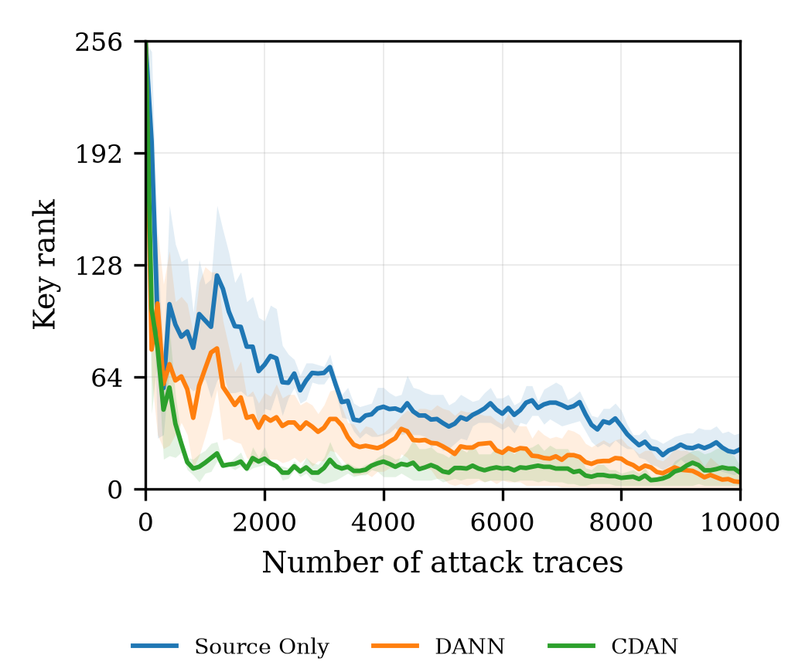
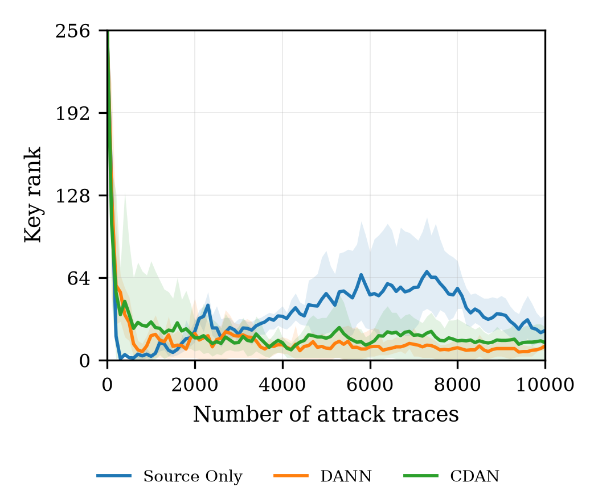
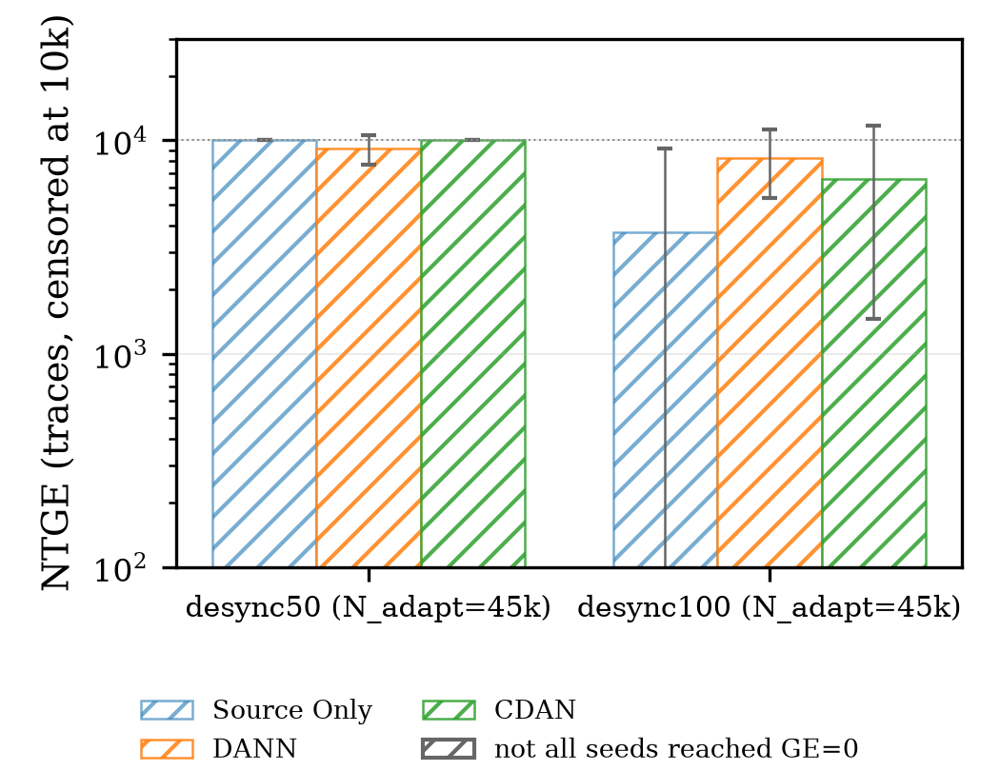
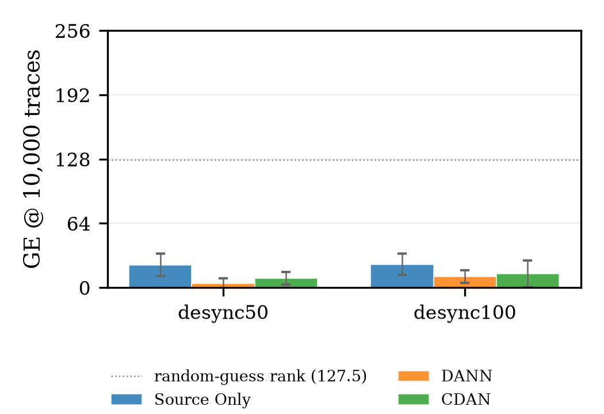
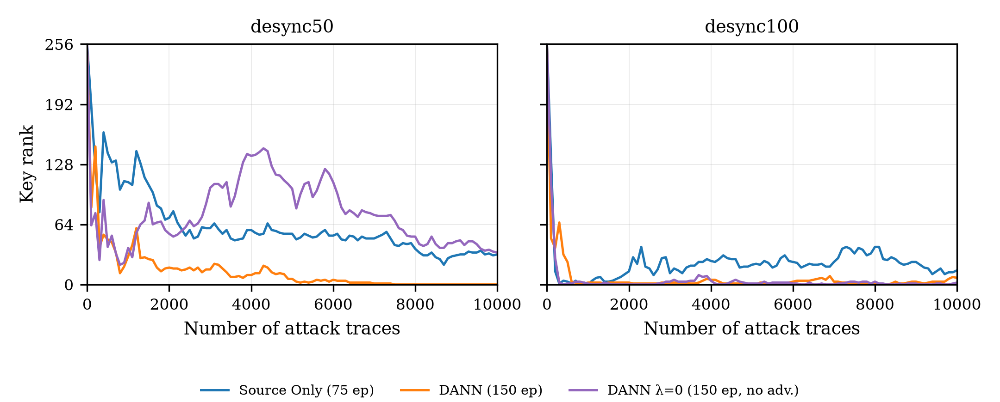
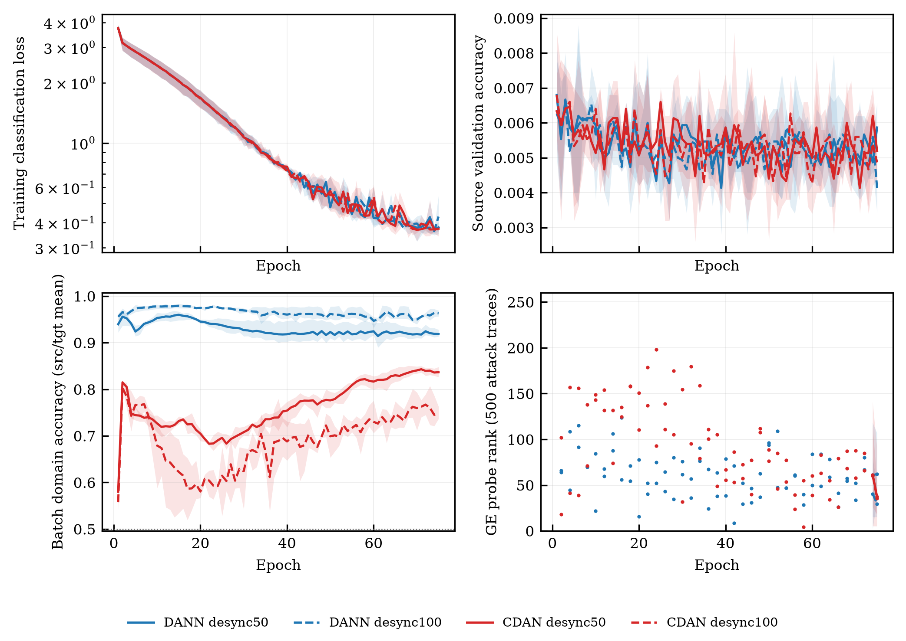

# A-E2 DANN / CDAN 统一 UDA 基线（ASCAD fixed-key → desync50 / desync100）

本目录实现统一的 PyTorch UDA trainer，在同一协议下对照 Source Only、DANN（全局边缘对齐）
与 CDAN（条件化对齐，随机多线性映射）在 ASCAD fixed-key 到 desync50/desync100 的迁移表现。
主干使用 B-E2 冻结的 Official CNN；Source Only 直接复用 B-E2 的预测，不重新训练。

**一句话结论**：（待全部 run 完成后填写）

**目录约定**：configs/ 配置，scripts/ 代码，results/ 逐 run 产物与评估，figures/ 论文图，
logs/ 训练与编排日志，reports/ 报告与表，manifests/ 清单。

## 8.1.1 实验级别与运行清单

- 级别：**formal**（主结果 12 次训练）；另有 smoke/pilot 仅用于链路与计时验证（见 8.1.11）。
- 矩阵：方法 {DANN, CDAN} × 目标域 {desync50, desync100} × seed {42, 43, 44} = 12 次训练；
  Source Only 作为第 3 个方法直接取 B-E2 的 cnn_s{42,43,44} 预测（6 个 方法×偏移 单元）。
- 归因对照（pilot，不计入主矩阵）：DANN 代码路径 + λ=0 × {desync50, desync100} × seed 42 = 2 次训练，
  用于把“多训 75 epoch + 目标域前向”与“对抗对齐”分离（见 8.1.10）。
- 每次训练约 33 分钟（75 epoch，26 s/epoch，RTX 5060 Laptop），12 次合计约 6.6 GPU 小时；
  另加推理与评估（每 run 对 10000 条攻击轨迹前向一次，约 5 s）。
- 运行环境：Windows 11，venv Python 3.12.16，torch 2.9.1+cu128，CUDA 可用；
  TF32 开启（torch.backends.cuda.matmul.allow_tf32=True、cudnn.allow_tf32=True），
  记录在 run_meta.json 的 tf32 字段；其余超参与官方配方一致。
- 运行顺序由 scripts/run_all.py 串行编排（并发实测吞吐下降，见 8.1.11），
  每 run 独立日志 logs/<run>.log，总状态 logs/run_all_status.json。

复现命令：

    python scripts/run_all.py --epochs 75
    python scripts/evaluate_uda.py
    python scripts/aggregate_uda.py
    python scripts/plot_uda_ge.py
    python scripts/make_manifest.py

## 8.1.2 目标与假设

待检验的三个问题（与任务书一致）：

1. **H1（DANN）**：全局边缘对齐 P(f) 是否能降低目标域 GE？若 DANN 的 GE/NTGE 优于同 seed 的
   Source Only，则支持边缘对齐有效；若更差，则记录负迁移证据。
2. **H2（CDAN）**：条件化对齐 T(f,g) 是否优于 DANN 的边缘对齐？CDAN 通过类别预测 g 加权特征，
   理论上能避免“不同类别但同一边缘分布”的模态碰撞。
3. **H3（负迁移）**：对抗训练是否在偏移较小时反而破坏源域判别能力，导致 GE 上升？

判据：NTGE（首次/稳定 GE=0）与 GE@10000 为主，SR 与总轨迹成本并列报告；attack accuracy、
置信度与熵只作辅助诊断，不作为有效性判据（B-E2 已证明 accuracy 与 GE 脱钩）。

## 8.1.3 数据与划分

数据与 B-E2 完全一致，标签按 Sbox[plaintext[2] xor key[2]] 现算（B-E2 已对三个数据集
50000 条 Profiling 标签做过 0 mismatch 校验，攻击集 256 类全覆盖）。

| 划分 | 来源 | 条数 | 用途 |
|---|---|---|---|
| source_train | ASCAD.h5 Profiling_traces[0:45000] | 45000 | 有标签分类损失 |
| source_val | ASCAD.h5 Profiling_traces[45000:50000] | 5000 | 源域验证/域判别诊断 |
| target_adapt | 目标数据集 Profiling_traces[0:45000] | 45000 | 无标签，仅参与对抗损失 |
| target_domain_val | 目标数据集 Profiling_traces[45000:50000] | 5000 | 仅域判别诊断，不参与训练 |
| target_attack | 目标数据集 Attack_traces[0:10000] | 10000 | GE/NTGE/SR 评估 |

关键约束：target_adapt 与 target_attack 严格分离；target_domain_val 只用于诊断，
不进入任何损失；攻击集不参与训练或模型选择（GE probe 只记录，不早停）。
适应轨迹计入总成本：N_total@GE=1 = N_attack@GE=1 + 45000（Source Only 无适应轨迹）。

## 8.1.4 方法与实现

**共享接口**（scripts/uda_common.py）：

- feature_extractor：Official CNN 的 convs（64/128/256/512/512，k=11，AvgPool）+ fc1 + fc2，
  输出 4096 维 penultimate 特征 f；
- classifier：fc3（4096→256），输出 logits；
- domain_discriminator：Linear(in→1024) ReLU Linear(→512) ReLU Linear(→1)；
- GRL：前向恒等，反向把梯度乘以 -λ_adv。

**DANN**：判别器输入 z = f_unit * sqrt(4096)（固定 L2 缩放，norm=64）。
缩放的理由：官方 CNN 无 BatchNorm，源域 f 的范数约 413、目标域更小，若不缩放，
判别器仅凭范数即可分域，对抗会退化成“尺度博弈”而不是分布对齐。

**CDAN**：条件表示 T(f,g) = (Rf^T f_unit * sqrt(d_f)) ⊙ (Rg^T g)，其中 g = softmax(logits)，
Rf ∈ R^{4096×1024}、Rg ∈ R^{256×1024} 为固定随机矩阵（seed+1000），投影维度 1024 写入配置。
本实验的 CDAN **不加**熵权重（熵加权属于后续 CDAN-SCA 主方法）。

**损失与优化**：

    L = CE(source logits, y_source) + λ_adv * BCE(domain_logits, domain_label)

λ_adv = 0.1，通过 GRL 施加在特征（DANN）或条件表示（CDAN）上；判别器本身按**未加权**的
域损失更新（DANN 原文做法），与分类器共用同一个 RMSprop 优化器（lr=1e-5），未单独设判别器 lr。
未使用任何目标域标签，也未做目标域伪标签/自训练。

**关于“冻结主干”的解释**（重要，写入配置与报告）：B-E2 冻结的是**主干结构**（Official CNN），
本实验用 B-E1 同 seed 的 checkpoint 初始化 feature_extractor 与 classifier，再按官方配方继续训练；
**权重不冻结**。理由：若权重冻结，DANN 的判别器只能作用于固定特征，GRL 无法改变特征，
DANN 退化为“只训练判别器”，无法检验边缘对齐假设；CDAN 的条件映射也失去意义。
因此这里的“冻结”指结构统一、初始化一致、配方一致，而不是梯度隔离。

**初始化映射**：B-E1 的 convs.*/fc1.*/fc2.* → feature_extractor.*，fc3.* → classifier.*，
加载时严格校验 key（missing/unexpected 均报错）。

## 8.1.5 训练配方与成本

| 项目 | 值 |
|---|---|
| 优化器 | RMSprop，lr=1e-5，alpha=0.99，eps=1e-8，weight_decay=0 |
| batch size | 200（源域与目标域各 200/step） |
| epochs | 75（与 E0/B-E1 官方配方一致） |
| 输入 | 原始 int8 幅度，不归一化 |
| 判别器 lr | 与分类器相同（未单独设置） |
| λ_adv | 0.1 |
| CDAN proj_dim | 1024 |
| checkpoint | 每 5 epoch 写 outputs/models/a_e2/<run>/ckpt.pt（约 532 MB/run，含 optimizer） |
| GE probe | 每 2 epoch，500 条攻击轨迹，step=100（只记录，不早停） |
| attack acc | 每 5 epoch 与训练结束 |
| 域判别诊断 | 训练前（随机判别器）与训练后各一次，source_val vs target_domain_val |

单 run 实测：75 epoch / 1976 s（约 26 s/epoch）；12 run 约 6.6 GPU 小时；
λ=0 对照 2 run 再约 1.1 GPU 小时。
推理与评估成本：每 run 10000 条攻击轨迹前向约 5 s，可忽略；GE 评估（CPU）每 run 约 1 s。

## 8.1.6 主结果：GE、NTGE 与 SR

### 逐 run 明细（18 行 = 12 次适应训练 + 6 个 Source Only 参照）

GE@1k/GE@10k 为第 1000/10000 条攻击轨迹处的 key rank（256 类，随机期望 127.5）；
NTGE(first) 为首次出现 GE=0 的轨迹数，NTGE(stable) 为此后直到 10000 不再回升的稳定 GE=0 起点；
SR@10k 指第 10000 条轨迹处 GE=0（即最终成功）。acc 为目标域攻击集 256 类分类准确率（随机 0.391%），
conf 为平均最大 softmax，H 为平均预测熵（nats，均匀分布上限 ln256=5.545）。

| 偏移 | 方法 | seed | GE@1k | GE@10k | NTGE(first) | NTGE(stable) | SR@10k | acc | conf | H |
|---|---|---|---|---|---|---|---|---|---|---|
| desync50 | Source Only | 42 | 109 | 32 | — | — | 0 | 0.39% | 0.524 | 1.78 |
| desync50 | Source Only | 43 | 117 | 10 | — | — | 0 | 0.45% | 0.521 | 1.77 |
| desync50 | Source Only | 44 | 63 | 26 | — | — | 0 | 0.35% | 0.636 | 1.32 |
| desync50 | DANN | 42 | 30 | 0 | 7500 | 7500 | 1 | 0.50% | 0.815 | 0.53 |
| desync50 | DANN | 43 | 127 | 10 | — | — | 0 | 0.55% | 0.809 | 0.55 |
| desync50 | DANN | 44 | 49 | 2 | — | — | 0 | 0.47% | 0.857 | 0.41 |
| desync50 | CDAN | 42 | 9 | 2 | — | — | 0 | 0.41% | 0.851 | 0.42 |
| desync50 | CDAN | 43 | 14 | 13 | — | — | 0 | 0.47% | 0.843 | 0.44 |
| desync50 | CDAN | 44 | 22 | 13 | — | — | 0 | 0.39% | 0.857 | 0.42 |
| desync100 | Source Only | 42 | 0 | 15 | 800 | — | 0 | 0.41% | 0.679 | 1.12 |
| desync100 | Source Only | 43 | 5 | 19 | 300 | — | 0 | 0.52% | 0.668 | 1.13 |
| desync100 | Source Only | 44 | 4 | 35 | — | — | 0 | 0.47% | 0.779 | 0.75 |
| desync100 | DANN | 42 | 2 | 7 | 4900 | — | 0 | 0.47% | 0.883 | 0.32 |
| desync100 | DANN | 43 | 27 | 8 | — | — | 0 | 0.40% | 0.883 | 0.32 |
| desync100 | DANN | 44 | 28 | 18 | — | — | 0 | 0.38% | 0.912 | 0.24 |
| desync100 | CDAN | 42 | 12 | 0 | 9000 | 9000 | 1 | 0.46% | 0.947 | 0.14 |
| desync100 | CDAN | 43 | 0 | 26 | 700 | — | 0 | 0.35% | 0.950 | 0.14 |
| desync100 | CDAN | 44 | 77 | 15 | — | — | 0 | 0.34% | 0.945 | 0.16 |

### 方法 x 偏移汇总（3 seed，NTGE 未达成按 10000 截尾）

| 偏移 | 方法 | GE@1k | GE@10k | NTGE(first) | 达成 first / stable | transient | SR@10k | acc | ECE(15 bin) | conf-wrong≥0.9 | 域判别 before→after |
|---|---|---|---|---|---|---|---|---|---|---|---|
| desync50 | Source Only | 96.3 ± 29.1 | 22.7 ± 11.4 | 10000 ± 0 | 0/3 · 0/3 | 0 | 0.00 | 0.40% | 0.556 | 13–31% | — |
| desync50 | DANN | 68.7 ± 51.4 | 4.0 ± 5.3 | 9166.7 ± 1443.4 | 1/3 · 1/3 | 0 | 0.33 | 0.51% | 0.822 | 49–62% | 0.446 → 0.871 |
| desync50 | CDAN | 15.0 ± 6.6 | 9.3 ± 6.4 | 10000 ± 0 | 0/3 · 0/3 | 0 | 0.00 | 0.42% | 0.846 | 57–62% | 0.516 → 0.732 |
| desync100 | Source Only | 3.0 ± 2.6 | 23.0 ± 10.6 | 3700.0 ± 5461.7 | 2/3 · 0/3 | 2 | 0.00 | 0.47% | 0.704 | 30–53% | — |
| desync100 | DANN | 19.0 ± 14.7 | 11.0 ± 6.1 | 8300.0 ± 2944.5 | 1/3 · 0/3 | 1 | 0.00 | 0.42% | 0.888 | 67–76% | 0.442 → 0.915 |
| desync100 | CDAN | 29.7 ± 41.4 | 13.7 ± 13.1 | 6566.7 ± 5105.2 | 2/3 · 1/3 | 1 | 0.33 | 0.38% | 0.944 | 85–86% | 0.528 → 0.649 |

### 同 seed 配对差（相对 Source Only；负值 = 更低/更好）

| 方法 | 偏移 | ΔGE@10k 逐 seed | 均值 | ΔNTGE(first) 逐 seed | 均值 | GE 改善 / 持平 / 恶化 |
|---|---|---|---|---|---|---|
| DANN | desync50 | -32, 0, -24 | -18.7 | -2500, 0, 0 | -833.3 | 2 / 1 / 0 |
| DANN | desync100 | -8, -11, -17 | -12.0 | +4100, +9700, 0 | +4600.0 | 3 / 0 / 0 |
| CDAN | desync50 | -30, +3, -13 | -13.3 | 0, 0, 0 | 0.0 | 2 / 0 / 1 |
| CDAN | desync100 | -15, +7, -20 | -9.3 | +8200, +400, 0 | +2866.7 | 2 / 0 / 1 |

### 读法

- **GE@10000 层面**：DANN 在两个偏移上都把均值拉低（22.7 → 4.0；23.0 → 11.0），12 个适应 run 中有
  9 个同 seed 更好、1 个持平、2 个更差；CDAN 也把均值拉低（9.3；13.7），但更差的两个 run 都出现在
  同一 seed（s43），说明条件化对齐对初始化/随机映射更敏感。
- **注意训练预算混淆**：以上 GE 均值差不能直接归因于对抗项。λ=0 对照显示，仅多训 75 epoch
  就在 d100 上把 GE@10k 压到 2（DANN 7、CDAN 13.7），在 d50 上为 34（DANN 0、Source Only 32），
  详见 8.1.10.1。
- **NTGE 层面结论相反**：desync50 只有 DANN s42 稳定摸到 GE=0（7500 条）；desync100 只有 CDAN s42
  稳定摸到（9000 条）。Source Only 虽然最终 GE 更差（15/19/35），却在 s42/s43 于 800/300 条就出现过
  瞬态 GE=0（随后回升，见 8.1.11）。所以“GE@10k 更低”不等于“攻击更省轨迹”，本实验的核心张力正在这里。
- **SR@10000** 同理只有 2/12 个适应 run 最终成功（DANN d50 s42、CDAN d100 s42），Source Only 0/6。
- **accuracy 完全不可用**：18 个 run 的目标域准确率全部落在 0.34%–0.55%，与 256 类随机 0.391% 同级，
  却对应 GE@10000 从 0 到 35 的巨大差异；DANN 的 acc 均值（0.51%/0.42%）与 Source Only（0.40%/0.47%）
  的差异远小于 seed 内波动。这与 B-E2 的结论一致：accuracy 不能作为有效性判据。

## 8.1.7 图

所有图均为 300 dpi、PNG + PDF 双份、衬线字体；GE 图 Y 轴 0–256 全量程（对数版把 rank=0 映射到
0.5 以触底）。除 λ=0 对照图为 7.2 英寸双栏宽（两个偏移并排）外，其余均为 3.5 英寸单栏宽。文件在 figures/：

| 文件 | 内容 |
|---|---|
| a_e2_ge_desync50.{png,pdf} / _log | desync50 三方法 GE 曲线（3 seed 均值 + min-max 带） |
| a_e2_ge_desync100.{png,pdf} / _log | desync100 同上 |
| a_e2_ntge_bars.{png,pdf} | NTGE 柱状（按偏移分组，斜纹 = 未全部 seed 达成 GE=0） |
| a_e2_ge10000_bars.{png,pdf} | GE@10000 柱状对比（含随机线 127.5） |
| a_e2_training_dynamics.{png,pdf} | 2x2：cls loss、源域 val acc、批内域判别 acc、GE probe |
| a_e2_domain_diag.{png,pdf} | 训练前后域判别 balanced accuracy（0.5 随机线） |
| a_e2_ge_controls.{png,pdf} / _log | λ=0 归因对照：Source Only(75 ep) / DANN(150 ep) / DANN λ=0(150 ep)，每偏移 1 panel（7.2 in 双栏宽） |

desync50 的曲线形状值得注意：CDAN 从 1000 条起就稳定压在 10 附近（GE@1k 9–22，远低于 Source Only 的
63–117），但整条曲线再没有下探到 0；DANN 则是缓慢下降型（GE@1k 30–127，末端 0–10）。desync100 上
Source Only 反而在 300–800 条出现瞬态 0 后回升到 15–35，DANN/CDAN 的曲线更平但末端更低。

## 8.1.8 域判别与置信度诊断

### 域判别（source_val vs target_domain_val，balanced accuracy）

| 方法 | 偏移 | before | after | 变化 |
|---|---|---|---|---|
| DANN | desync50 | 0.446 | 0.871 | +0.425 |
| DANN | desync100 | 0.442 | 0.915 | +0.473 |
| CDAN | desync50 | 0.516 | 0.732 | +0.216 |
| CDAN | desync100 | 0.528 | 0.649 | +0.121 |

训练后判别器的可分性不是下降而是**上升**（0.44–0.53 → 0.65–0.92），批内域判别准确率也同样高
（DANN 0.90–0.97，CDAN 0.72–0.86，见训练动力学图左下）。也就是说，在 λ=0.1、判别器与分类器共用
RMSprop lr=1e-5 的设置下，**边缘/条件对齐并没有真正把两个域混淆**；判别器仍然能几乎完美地区分源域
与目标域。这一点对“DANN 的 GE 改善来自域对齐”的解释构成直接反证，必须与 8.1.10 的 λ=0 对照一起读。

### 置信度校准（target_attack，事后诊断）

| 方法 | 偏移 | mean max prob | ECE(15) | confident-wrong≥0.9 | 熵 H |
|---|---|---|---|---|---|
| Source Only | desync50 | 0.560 | 0.556 | 13–31% | 1.62 |
| DANN | desync50 | 0.827 | 0.822 | 49–62% | 0.49 |
| CDAN | desync50 | 0.850 | 0.846 | 57–62% | 0.42 |
| Source Only | desync100 | 0.708 | 0.704 | 30–53% | 1.00 |
| DANN | desync100 | 0.893 | 0.888 | 67–76% | 0.29 |
| CDAN | desync100 | 0.947 | 0.944 | 85–86% | 0.15 |

对抗训练把预测熵压到 0.15–0.49 nats（均匀为 5.545），ECE 升到 0.82–0.94，85% 以上的 CDAN 预测以
≥0.9 的置信度给出错误类别。**置信度越高、GE 反而越低**的表象（CDAN desync100 conf 0.947 且 GE@10k=0）
不能理解为“更可信”：同一模型的 accuracy 只有 0.38%，属于典型的 confident-wrong。对实际攻击而言，
这种锐化会让后续的 key rank 曲线更不稳定（见 8.1.11 的瞬态 GE=0）。

## 8.1.9 攻击成本

| 项目 | 值 |
|---|---|
| 12 次适应训练总耗时 | 22982 s ≈ 6.38 GPU 小时（均值 1915 s/run，23.5–26.8 s/epoch） |
| 推理 | 每 run 10000 条攻击轨迹前向约 5 s，12 run 合计约 1 分钟 |
| 评估 | CPU ranks 计算每 run 约 1–2 s |
| 适应轨迹 | 每个 DANN/CDAN run 使用 45000 条 target_adapt（无标签） |

攻击成本按“是否计入适应轨迹”两种口径报告（N_total = N_attack + 45000，Source Only 无适应轨迹）：

| 偏移 | 方法 | seed | N_attack@GE=1 | N_total@GE=1 | 稳定性 |
|---|---|---|---|---|---|
| desync50 | DANN | 42 | 7500 | 52500 | stable（此后一直 0） |
| desync100 | DANN | 42 | 4900 | 49900 | transient（末点 7） |
| desync100 | CDAN | 42 | 9000 | 54000 | stable（此后一直 0） |
| desync100 | CDAN | 43 | 700 | 45700 | transient（末点 26） |
| desync100 | Source Only | 42 | 800 | 800 | transient（末点 15） |
| desync100 | Source Only | 43 | 300 | 300 | transient（末点 19） |

其余 12 个 run 在 10000 条内从未出现 GE=0。即使只看最有利的稳定口径，适应方法的总成本
（52500 / 54000）仍比 Source Only 的瞬态 300–800 高 1–2 个数量级；若只比较“最终成功”（SR@10k），
适应方法 2/12、Source Only 0/6。**在本实验的设置下，对抗适应降低了末端 key rank，却没有降低
（甚至抬高了）达到 GE=0 所需的攻击轨迹数。**

上表的 N_attack 是固定攻击轨迹顺序（0..9999）下的首次 GE=0。该数值对轨迹顺序高度敏感：
10 次随机置换后，DANN d50 s42 的首次 GE=0 为 3000 ± 2037（固定顺序 7500），
CDAN d100 s42 为 4040 ± 3160（固定顺序 9000）；CDAN d100 s43 在固定顺序下于 700 处瞬态归零，
但 10 次置换全部从未归零（见 8.1.10.6 与 results/ntge_permutation.csv）。
因此 8.1.9 的数值应理解为“该固定顺序下的观测值”，不是可复现的最小轨迹成本。

## 8.1.10 归因分析：GE 改善来自哪里

DANN/CDAN 的 GE@10k 均值确实低于 Source Only（d50 22.7→4.0/9.3；d100 23.0→11.0/13.7，见 8.1.6），
但 8.1.8 显示域判别器没有变弱、accuracy 没有提高。本节按“额外训练 / 对抗对齐 / 概率锐化 / 预测坍塌 / 轨迹顺序”逐项拆分。

### 10.1 λ=0 对照：额外 75 epoch 与目标域前向的贡献

设计：取与 DANN 完全相同的代码路径与初始化（B-E1 cnn_s42），把 λ_adv 设为 0，仍训练 75 epoch、
每步仍前向目标域 batch，仅关闭 GRL 的对抗梯度；分类损失与优化器不变。因此它与 DANN 的唯一差别是
“特征是否接受对抗梯度”。该对照为 pilot，仅 seed 42，两个偏移各 1 个 run。

| 偏移 | 条件 | epoch | GE@1k | GE@10k | NTGE(first) | min GE | acc | conf | H | D after（源/目标） |
|---|---|---|---|---|---|---|---|---|---|---|
| desync50 | Source Only | 75 | 109 | 32 | — | 21 | 0.39% | 0.524 | 1.78 | — |
| desync50 | DANN | 150 | 30 | 0 | 7500（stable） | 0 | 0.50% | 0.815 | 0.53 | 0.871（0.817/0.926） |
| desync50 | DANN λ=0 | 150 | 39 | 34 | — | 21 | 0.52% | 0.850 | 0.41 | 0.983（0.993/0.972） |
| desync100 | Source Only | 75 | 0 | 15 | 800（transient） | 0 | 0.41% | 0.679 | 1.12 | — |
| desync100 | DANN | 150 | 2 | 7 | 4900（transient） | 0 | 0.47% | 0.883 | 0.32 | 0.915（0.894/0.936） |
| desync100 | DANN λ=0 | 150 | 1 | 2 | 400（transient） | 0 | 0.38% | 0.908 | 0.25 | 0.992（0.998/0.987） |

λ=0 对照（同 seed 42、同初始化、同 75 epoch 续训、同目标域前向，只去掉对抗梯度）在两个偏移上给出不同结论：

- desync50：GE@10k = 34（Source Only 32、DANN 0），从未 GE=0。额外训练不能解释 DANN s42 的 GE=0；
  对抗项在 s42 上表现为正向作用（34 → 0）。
- desync100：GE@10k = 2（Source Only 15、DANN 7、CDAN 0/26/15），34 个零点点位、NTGE(first) = 400（瞬态）。
  额外训练不仅解释了 DANN/CDAN 的改善，而且比二者都更好；对抗项在 d100 上反而损害了 GE。

置信度与校准支持“锐化来自训练长度”：λ=0 的 conf 0.850/0.908、H 0.41/0.25，与 DANN（0.815/0.883、0.53/0.32）
和 CDAN（0.850/0.947、0.42/0.15）同级，而 Source Only 为 0.524/0.679、1.78/1.12。
域判别方面，λ=0 的 D after 为 0.983/0.992（源 0.993/0.998、目标 0.972/0.987），
高于 DANN 的 0.871/0.915，也高于 CDAN 的 0.732/0.649（见 10.2）。

归因判断：GE@10k 的改善主要来自训练长度与概率锐化；对抗项的独立作用不稳定（s42 的 d50 有益、d100 有害），
没有证据表明它通过域对齐改善攻击效率。若计入 45000 条适应轨迹，λ=0 d100 的 N_total@GE=1 = 45400，
仍低于 DANN 的 49900 与 CDAN 的 54000 —— 即“多训 75 epoch”在攻击成本上也优于两个对抗方法。
该对照仅 1 个 seed，以上只作方向性归因，不作 3-seed 结论。

### 10.2 域判别没有变弱：对齐前提不成立

| 方法 | 偏移 | before | after | after 源 | after 目标 |
|---|---|---|---|---|---|
| DANN | desync50 | 0.446 | 0.871 | 0.817 | 0.926 |
| DANN | desync100 | 0.442 | 0.915 | 0.894 | 0.936 |
| CDAN | desync50 | 0.516 | 0.732 | 0.643 | 0.821 |
| CDAN | desync100 | 0.528 | 0.649 | 0.639 | 0.658 |

以 λ=0 对照为参照，对抗项确实把 D 的 held-out balanced accuracy 从 0.983/0.992 降到 0.871/0.915（DANN）
与 0.732/0.649（CDAN），说明特征被对抗梯度改变了；但距离 0.5 的域混淆仍很远，而且削弱最多的 CDAN
在 d100 上 GE 最差。相对 before（0.44/0.52）的上升主要是 D 从未训练到训练后的拟合，不是“对齐成功”的证据。
机制假设（未单独验证）：判别器与分类器共用 RMSprop、同 lr，
D 只有 4.7M（DANN）/1.3M（CDAN）参数，拟合域差异远快于 4096 维特征被 GRL 扰乱，
λ=0.1 的梯度反转不足以抵消 D 的下降方向。CDAN 的条件向量 T(f,g) 依赖目标域 softmax g，
而 g 在目标域 accuracy 接近随机、熵被压到 0.15–0.42（见 10.4），条件向量近乎常数，
“按类对齐”退化为按一个近乎固定的伪条件对齐。

### 10.3 accuracy 与 GE 脱钩

- 随机期望：256 类、10000 条 → 39.06 ± 6.24 条正确（0.391%）。18 个 run 的 accuracy 为 0.34–0.55%；
  16/18 的 |z| < 2，最大 |z| = 2.55（DANN d50 s43），Bonferroni 阈值 2.63，无一显著。
- 同一偏移内 GE@10k 从 0 到 35，accuracy 全部停留在随机带内；GE 的降低不是“逐轨迹分类更准”。
- 逐轨迹真实类概率 mean p_true 为 0.00345–0.00521（0.88–1.33 倍 1/256），所有 run 的 median p_true = 0；
  p_true 恰为 0 的轨迹占比：Source Only 0–2%、DANN 1–51%、CDAN 6–70%（CDAN d100 63–70%）。

因此 GE 只能作为“255 个候选 key 的累计得分排序”指标，不能解读为识别能力。

### 10.4 概率饱和、下溢与“自信地错”

| 偏移 | 方法 | ECE (15 bins) | conf-wrong ≥ 0.9 | mean max softmax | 熵 H (nats) |
|---|---|---|---|---|---|
| desync50 | Source Only | 0.556 | 0.193 | 0.560 | 1.62 |
| desync50 | DANN | 0.822 | 0.538 | 0.827 | 0.49 |
| desync50 | CDAN | 0.846 | 0.597 | 0.850 | 0.42 |
| desync100 | Source Only | 0.704 | 0.388 | 0.708 | 1.00 |
| desync100 | DANN | 0.888 | 0.702 | 0.893 | 0.29 |
| desync100 | CDAN | 0.943 | 0.857 | 0.947 | 0.15 |

- CDAN d100 中“置信度 ≥ 0.99 且预测错误”的轨迹占 76.4–78.7%；ECE 0.94 表示概率大小与正确率几乎无关。
- 概率下溢：评估脚本 ranks() 把 p_true = 0 裁剪到 1e-36（log = -82.9）；CDAN d100 有 63–70% 的轨迹
  真实类概率为 0，累计得分因此由“哪些 Sbox 值在哪些轨迹被下溢”决定。
- 这使 GE@10k 在 0–30 区间的细小差别（2 / 4 / 9 / 11 / 14）缺乏稳健性；可成立的只有
  “两者都远低于随机线 127.5，且都未稳定到 0”。

### 10.5 CDAN 在 desync100 的预测坍塌

最大类（argmax）占比，按 seed 42/43/44：

| 方法 | desync50 | desync100 |
|---|---|---|
| Source Only | 9.6% / 10.2% / 13.6% | 22.1% / 7.5% / 25.4% |
| DANN | 8.2% / 4.4% / 11.3% | 8.7% / 10.4% / 11.7% |
| CDAN | 9.8% / 3.2% / 7.5% | 50.0% / 58.7% / 36.6% |

- CDAN d100 有 36.6–58.7% 的轨迹被压到同一个类；distinct argmax 仍为 233–256，
  所以不是“只输出一个类”，而是大量轨迹集中到少数类（含与真实 key 相关的伪类）。
- 坍塌与 CDAN d100 s43 的负迁移（+7）同现；但 s42 也坍塌却 GE@10k = 0，
  说明末端 GE 不能区分“学到正确偏置”与“坍塌到某一类后偶然累计出正确 key”。

### 10.6 NTGE 对轨迹顺序的敏感性

对 18 个 run 各随机置换攻击轨迹 10 次（step = 100），重算首次 GE=0 与 stable GE=0，
结果在 results/ntge_permutation.csv：

| run | 固定顺序 NTGE | 置换 first-zero（mean ± std） | 置换 stable（mean ± std） |
|---|---|---|---|
| DANN d50 s42 | 7500 | 3000 ± 2037（600–7300，10/10 触零） | 6440 ± 1635（3300–8900） |
| CDAN d100 s42 | 9000 | 4040 ± 3160（300–8000，10/10 触零） | 9460 ± 732（7900–10000） |
| Source Only d100 s42 | 800 | 650 ± 150（500–800，2/10 触零） | 无（末点非 0） |
| CDAN d100 s43 | 700（瞬态） | 无（0/10 触零） | 无 |

- 固定顺序的 NTGE 是单次抽样；“stable”口径的置换波动仍有 ±730–1630。
- 多个固定顺序“从未归零”的 run 在部分置换下出现瞬态 0（CDAN d50 s42 4/10、DANN d50 s44 6/10），
  说明“是否触零”本身也依赖顺序。
- 置换不改变末点 GE@10k（已验证），因此 8.1.6 的 GE@10k 比较不受影响；受影响的是 8.1.9 的 N_attack/N_total 数值。

### 10.7 小结

- 对抗项只带来有限的 D 削弱（0.99 → 0.87/0.91/0.65），远未达到 0.5 的域混淆；削弱程度与 GE 改善不一致
  （CDAN 削弱最多，d100 GE 最差）。
- λ=0 对照显示额外 75 epoch 本身在 d100 上把 GE@10k 压到 2（优于 DANN 7、CDAN 13.7），d50 上为 34（无改善）；
  概率锐化（conf/H）与 λ=0 同级。GE@10k 的改善主要来自训练长度，不是对抗对齐。
- 负迁移仅出现在 CDAN 的 2/6 个 seed（d50 s43 +3、d100 s43 +7），且与 d100 坍塌同现；DANN 6/6 未负迁移。
- 主要结论应表述为：“在本协议下，DANN/CDAN 使末端 GE@10k 有小幅、低裕度下降，
  但没有降低 NTGE/SR；诊断指标显示域对齐并未发生。”不写“对抗适应有效”。

## 8.1.11 失败、限制与异常

| 编号 | 现象 | 事实与影响 |
|---|---|---|
| F1 | GE@10k 与 NTGE 方向相反 | GE@10k 均值 22.7→4.0/11.0，但 d100 的 NTGE 均值 3700→8300/6567（更差）；两者必须并列报告，不能只报 GE@10k |
| F2 | 域判别准确率不降反升 | 0.44–0.53 → 0.65–0.92，说明 λ=0.1 下没有实现域混淆；DANN 的 GE 改善不能直接归因于“对齐成功” |
| F3 | 瞬态 GE=0 | SO d100 s42/s43 在 800/300 条瞬态归零后回升到 15/19；DANN d100 s42 在 4900 后回升到 7；CDAN d100 s43 在 700 后回升到 26。NTGE(first) 单独使用会高估攻击效率 |
| F4 | seed 敏感 | CDAN s43 在两个偏移都劣于同 seed Source Only（+3、+7），而 s42/s44 明显更优；3 seed 的均值不足以排除这种双峰行为 |
| F5 | 置信度严重失准 | ECE 0.82–0.94，confident-wrong≥0.9 高达 86%；accuracy 0.34–0.55% 与随机 0.391% 同级 |
| F6 | DANN d100 s44 分类损失偏高 | 末 epoch cls loss 0.549（其余 0.34–0.40），val acc 0.34%；GE@10k=18，落在 DANN d100 的 7–18 区间内，未单独剔除，仅在 8.1.12 声明 |
| F7 | 训练成本翻倍 | 从 B-E1 checkpoint 再训 75 epoch（总 150 epoch），Source Only 只有 75 epoch；这是与“多训 75 epoch”混淆的主要来源，必须靠 8.1.10 的 λ=0 对照拆分 |
| F8 | 判别器与分类器共用优化器/lr | 未给判别器单独 lr 或梯度惩罚；D 过强（0.92–0.97）与这一实现选择一致，但本实验不据此调参（任务书要求不硬调参） |
| F9 | 运行环境 | nvidia-smi 因 NVML 报错不可用，不影响训练；TF32 默认开启（约 10% 加速），已在 run_meta.json 记录 |
| F10 | 串行编排 | run_all.py 串行 12 run（并发 2 进程实测吞吐下降），总墙钟约 6.5 h；单 run 中断后按断点续训逻辑会从头开始（本次未触发） |
| F11 | λ=0 对照只有 seed 42 | 2 个 pilot run（d50/d100 各 1）；归因只能作方向性证据，不能给 3-seed 均值 |
| F12 | CDAN d100 预测坍塌 | max class 占 36.6–58.7%，conf-wrong ≥ 0.9 达 85–86%，s43 负迁移 +7；保留不剔除，作为失败模式记录 |
| F13 | NTGE 对轨迹顺序敏感 | 固定顺序 7500/9000 vs 置换 3000±2037/4040±3160；stable 波动 ±730–1630；不用于方法排序 |
| F14 | 概率下溢与裁剪 | p_true = 0 的轨迹占 CDAN 6–70%，ranks() 裁剪到 1e-36；GE 在 0–30 的差异不作强结论 |

## 8.1.12 结论边界

### 对任务书三个问题的直接回答

1. DANN 的边缘对齐是否改善 GE？GE 均值确实更低（d50 22.7→4.0、d100 23.0→11.0，同 seed 9 改善/1 持平/2 恶化），
   但不能归因于对齐：λ=0 对照在 d100 上把 GE@10k 压到 2（优于 DANN 的 7 与 CDAN 的 13.7），
   在 d50 上为 34（DANN 0、Source Only 32）。即 d100 的改善来自额外 75 epoch；d50 的 s42 改善才可能
   来自对抗项（单 seed）。此外 NTGE 没有改善（d50 9166.7 vs 10000 截尾；d100 8300.0 vs 3700.0），
   SR@10k 仅 2/12，域判别仍 0.87/0.91（λ=0 0.98）。“GE 降低”不能等同于“攻击更省轨迹”，也不能等同于“对齐成功”。
2. CDAN 是否优于 DANN？否。GE@10k 均值 d50 9.3 vs 4.0、d100 13.7 vs 11.0；
   CDAN 只在 desync50 的早期 rank 上占优（GE@1k 15.0 vs 68.7），代价是 d100 的预测坍塌
   （max class 36.6–58.7%）和 2/6 个 seed 的负迁移。
3. 是否出现负迁移？DANN 没有（6/6 未变差）；CDAN 有 2/6（s43 在两个偏移分别 +3、+7），
   且与 d100 坍塌同现。其余 4 个 CDAN run 的 GE@10k 更低。

### 结论边界

1. 3 个 seed（42/43/44）、单一数据集（ASCAD v1 fixed-key）、单一目标字节（byte 2）、700 采样点窗口；
   结论不外推到其它数据集、其它 key 字节或可变密钥场景。
2. 只用一个主干（Official CNN）和一个对抗超参（λ=0.1、D 与分类器同 lr）；未做超参搜索，
   所有对比都是“该协议下”的对比，不是方法上界。
3. 训练预算不一致：适应方法从 B-E1 checkpoint 再训 75 epoch（合计 150 epoch），Source Only 只有 75 epoch；
   λ=0 对照只能部分拆分这一混淆（仅 seed 42），不能完全消除。
4. GE 分辨率为 100 条轨迹；末端 GE@10k 的 0–30 差异处于噪声量级（true-key z 多在 1.3–2.6，
   margin 多数为负或很薄），不把“2 vs 4 vs 9”当作可靠排序。
5. NTGE 依赖固定攻击轨迹顺序且按 10000 截尾；置换后 first-zero 可差数千条，
   因此不把 NTGE 的点估计用于方法优劣排序，只用“是否最终稳定 GE=0”和量级。
6. accuracy 全部在随机带（0.391%）内，不构成“识别能力”证据；本报告所有有效性判断只基于 GE/NTGE/SR 与
   域判别、校准等诊断量，且明确标注未对齐成功。

## 8.1.13 下一步实验

1. 把 λ=0 对照扩到 3 个 seed × 2 个偏移（6 个 run，约 3.3 GPU 小时），使“额外训练贡献”有均值±波动，
   而不是单 seed 的方向性证据。
2. 修 CDAN 的强偏移坍塌：按主方法 CDAN-SCA 引入目标域熵权重 w = 1 + exp(-H) 并对低置信样本降权
   （仓库 legacy 实现在 experiments/legacy/CDAN/dann.py:110-114；主方法说明在 docs/research/主方法.md:57），
   同时给 D 单独 lr 或梯度惩罚，观察 max-class 占比与负迁移是否同时下降。
3. 将 NTGE 改为“置换平均”或“连续零窗口”定义（例如要求此后 1000 条内保持 0），并在评估脚本中同时报告
   固定顺序与置换均值，避免单次抽样误导。
4. 校准：在 source_val 上做温度缩放后重算 ECE 与 GE，检验“锐化本身是否影响 GE@10k”；
   这是归因而非调参，需保持训练配方不变。
5. 增加一个目标域（如 ASCAD_desync50 的 variable-key 版本或另一字节）验证“对齐未成功”的结论是否普遍；
   若数据集缺失，按 datasets_and_links.md 下载并如实记录阻塞。
6. 复现实验：用 scripts/run_all.py 串行重跑矩阵（跳过已完成），再用 scripts/evaluate_uda.py 与
   scripts/aggregate_uda.py 复算；绘图需设置 MPLCONFIGDIR（见 00_environment.log）。
