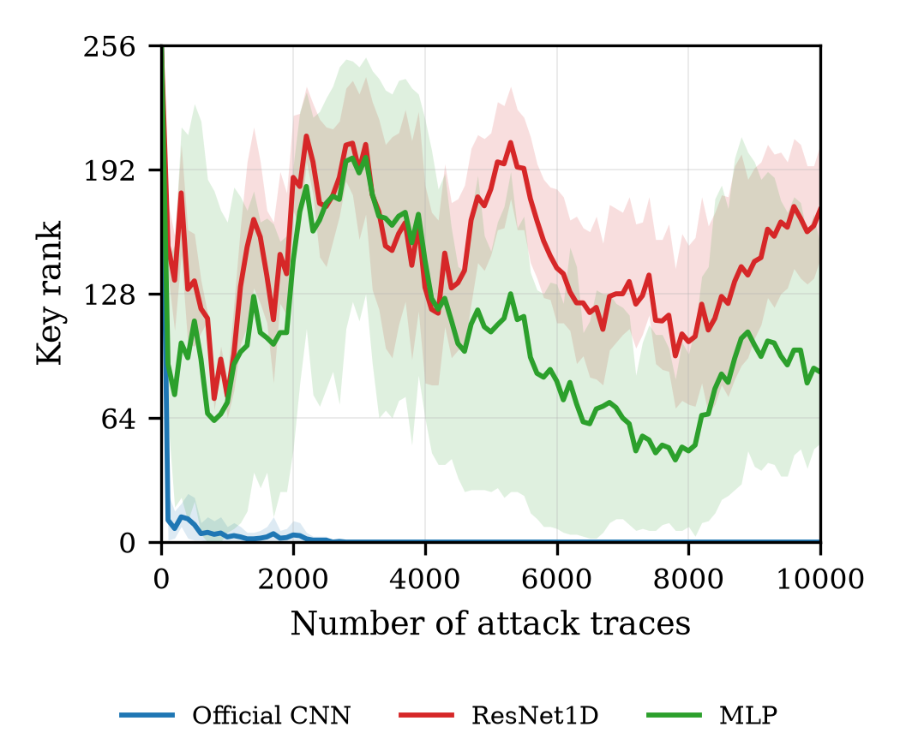

# B-E1 结构筛选：MLP / 官方 CNN / ResNet1D 同域复现（ASCAD fixed-key）

> 实验编号：B-E1（成员 B 第一轮）
> 目录：`experiments/02_member_b_method/b_e1_architecture_same_domain/`
> 生成时间：2026-11-09

## 8.1.1 实验级别

**Formal**：主结果 = 3 种主干 × 3 个 seed（42/43/44）= 9 次完整训练，统一配方、统一划分、统一评估口径。
**Pilot（补充诊断）**：3 次额外运行（MLP 提高 lr、MLP 缩小训练集、ResNet1D 提高 lr），仅用于归因，不进入主对比表，结果见 8.1.11。

## 8.1.2 研究问题

1. 在同一 ASCAD fixed-key 同域协议、同一训练配方下，MLP / 官方五层 CNN / ResNet1D 三种主干的**同域建模能力**（以 GE/key rank 判定）差异有多大？
2. 哪一种结构适合作为后续 UDA 主线（CDAN-SCA 及其基线 DANN / CDAN / CDPA-MMD / AdaBN）的共享特征提取器？

## 8.1.3 研究假设

- H1：官方五层 CNN 同域最强，与 E0 结论一致（E0 seed=42 得 NTGE=800、GE@10000=0、SR@1000=100%）。
- H2：ResNet1D 参数少（150 万，约为 CNN 的 2.3%），残差结构可能收敛更快或更稳。
- H3：MLP 在"原始 int8 幅度输入 + RMSprop lr=1e-5 + 75 epoch"的官方配方下可能学不动（该配方是为深层 CNN 调出来的）。

## 8.1.4 数据与划分

| 项 | 值 |
| --- | --- |
| 数据集 | ASCAD v1 fixed-key，`D:/sca_project/ASCAD_data/ASCAD.h5`（50000 profiling + 10000 attack，700 采样点，int8） |
| 源域 | ASCAD fixed-key Profiling（同域实验，源域=目标域数据分布） |
| 目标域 | 同域（**不是**跨设备/跨分布；本轮只做结构筛选） |
| source_train | Profiling_traces[0:45000]（45000 条，带标签） |
| source_val | Profiling_traces[45000:50000]（5000 条，仅早停/监控，未用于选模型） |
| target_adapt | **无**（同域 Source Only，不存在无标签适应轨迹） |
| target_attack | Attack_traces[0:10000]（10000 条） |
| 目标字节 | byte = 2（第 3 字节） |
| 真实密钥字节值 | 224（脚本启动时打印并写入 run_meta.json） |
| 标签定义 | `label = Sbox[plaintext[2] XOR key[2]]`，256 类 ID 模型 |
| 预处理 | 原始 int8 幅度，**不归一化**（与 E0 一致） |
| 输入形状 | (N, 1, 700) |

划分与 E0 完全一致（`experiments/00_common_e0/scripts/train_e0_torch.py` 的 `Xp[:-5000]` / `Xp[-5000:]`），可直接与 E0 数值对照。

**轨迹成本口径**：本实验没有适应轨迹，因此
`N_attack@GE=1 = N_total@GE=1 = NTGE`（GE 首次降为 0 的攻击轨迹数）。

## 8.1.5 方法与对比

- **baseline（参照）**：E0 官方五层 CNN，seed=42（同一配方、同一划分、同一评估脚本）。
- **本实验对比对象**：三种主干，其余全部相同。

| 主干 | 结构 | 参数量 |
| --- | --- | --- |
| MLP | Flatten(700) → Dense(512, ReLU) → Dense(512, ReLU) → Dense(256) | 752,896 |
| 官方 CNN | Conv1D 64/128/256/512/512（k=11，每层 AvgPool2）→ Flatten → Dense(4096) → Dense(4096) → Dense(256) | 66,652,544 |
| ResNet1D | 3 个残差块（每块 2×Conv1D k=11 + 1×1 投影 shortcut），通道 64/128/256，stride 1/2/2 → GlobalAvgPool → Dense(256) | 1,505,600 |

- 官方 CNN **直接复用** `train_e0_torch.py` 中的 `OfficialCNN`（通过 importlib 加载，不重写），保证与 E0 结构逐层一致。
- ResNet1D 参照 DASA-SCA 论文设定：3 个残差块、步长 [1,2,2]（通道宽度按本项目规模取 64/128/256）。
- **ablation**：本轮唯一自变量是 backbone，无其它消融。

## 8.1.6 固定变量与自变量

- 自变量（唯一）：backbone ∈ {mlp, cnn, resnet1d}
- 固定：数据集、划分、输入预处理、优化器与 lr、batch size、epoch 数、随机种子集合、GE 评估步长、目标字节。
- 单变量纪律：本轮不同时改动 loss、数据增强或训练预算。

## 8.1.7 运行配置

| 项 | 值 |
| --- | --- |
| seed | 42 / 43 / 44（每个结构各 3 次） |
| optimizer | RMSprop（PyTorch `torch.optim.RMSprop`，默认参数） |
| learning rate | 1e-5 |
| batch size | 200 |
| epochs | 75（固定跑满，未启用早停，与 E0 实际行为一致） |
| lambda / 对抗参数 | 不适用（Source Only） |
| GE 评估 | attack 集 10000 条，step=100，target byte=2 |
| 训练中 GE 探针 | 500 条攻击轨迹，第 1 epoch + 每 2 epoch（与 E0 相同） |
| 代码版本 | 运行时代码基线 commit `23dfc0e`（B-E1 脚本当轮新增，最终以本实验提交 commit 为准，见 `manifests/manifest.json`） |
| 环境 | PyTorch 2.9.1+cu128、NumPy 2.5.3、Python 3.12（`venv_exp`）、NVIDIA RTX 5060 Laptop GPU |
| 运行入口 | `scripts/run_b_e1_all.sh` → `scripts/train_b_e1.py`（逐 run 串行） |
| 评估入口 | `scripts/evaluate_b_e1.py`（复用 `experiments/cdan-sca-diagnosis/scripts/evaluate_ascad.py::ranks`） |
| 汇总入口 | `scripts/aggregate_b_e1.py` → `results/metrics.csv`、`results/summary.json` |
| 绘图入口 | `scripts/plot_b_e1_ge.py` → `figures/b_e1_ge_curves{,_log}.{png,pdf}`、`figures/b_e1_ntge.{png,pdf}` |

## 8.1.8 指标

- **GE / key rank**：每 100 条攻击轨迹记录一次真实密钥的排名（0 = 完全恢复），Y 轴全量程 0–256。
- **SR@1000 / SR@10000**：该轨迹预算下 GE=0 视为成功。
- **NTGE**：GE 首次等于 0 所需的攻击轨迹数（未达到记为 None）。
- **target accuracy**：攻击集上的 256 类分类准确率，仅作辅助，**不作为有效性判据**。
- **domain accuracy**：不适用（同域实验，无域判别器）。
- 训练集/验证集 accuracy 仅用于监控训练是否在学（本实验显示它在本任务上与 GE 脱钩，见 8.1.10）。

## 8.1.9 结果

9 次训练全部完成：每个 run 都跑满 75 epochs，无早停、无中途重跑（唯一一次中断见 8.1.11）。逐 epoch 指标在 `results/<run>/history.json`，GE 曲线在 `results/eval/<run>_ge.csv`。

### 主结果（结构 × seed，统一配方 lr=1e-5）

| 结构 | seed | 参数量 | NTGE | GE@1000 | GE@10000 | SR@1000 | SR@10000 | val acc | 训练耗时 (s) |
| --- | --- | --- | --- | --- | --- | --- | --- | --- | --- |
| 官方 CNN | 42 | 66,652,544 | **1000** | 0 | 0 | 1 | 1 | 0.0058 | 1180 |
| 官方 CNN | 43 | 66,652,544 | **700** | 0 | 0 | 1 | 1 | 0.0064 | 1188 |
| 官方 CNN | 44 | 66,652,544 | **2600** | 8 | 0 | 0 | 1 | 0.0054 | 1179 |
| MLP | 42 | 752,896 | — | 165 | 153 | 0 | 0 | 0.0034 | 25 |
| MLP | 43 | 752,896 | 700\* | 5 | 51 | 0 | 0 | 0.0038 | 24 |
| MLP | 44 | 752,896 | — | 46 | 59 | 0 | 0 | 0.0050 | 25 |
| ResNet1D | 42 | 1,505,600 | — | 78 | 163 | 0 | 0 | 0.0042 | 2115 |
| ResNet1D | 43 | 1,505,600 | — | 84 | 205 | 0 | 0 | 0.0042 | 2059 |
| ResNet1D | 44 | 1,505,600 | — | 64 | 146 | 0 | 0 | 0.0036 | 1862 |

- NTGE 分辨率为评估步长 100 条（即 700 / 1000 / 2600），"—" 表示 10000 条轨迹内 GE 从未到 0。
- \* MLP seed=43 的 NTGE=700 是**非单调的瞬态**：GE 在第 700 条降到 0 后于 10000 条处回升到 51，不构成有效密钥恢复（详见 8.1.10）。
- 随机猜密钥的期望 rank = 128.5（256 个候选等概率时的平均排名），可作为"无信息"参照线。

### 均值 ± 标准差（每个结构 n=3 seed）

| 结构 | NTGE | GE@1000 | GE@10000 | SR@1000 | SR@10000 | val acc | 训练耗时 (s) | 每 epoch (s) |
| --- | --- | --- | --- | --- | --- | --- | --- | --- |
| 官方 CNN | 1433 ± 1021 | 2.7 ± 4.6 | **0.0 ± 0.0** | **0.67 ± 0.58** | **1.00 ± 0.00** | 0.0060 ± 0.0010 | 1182 ± 5 | 15.8 ± 0.1 |
| MLP | 700（仅 1/3 达到） | 72.0 ± 83.1 | 87.7 ± 56.7 | 0 | 0 | 0.0040 ± 0.0010 | 25 ± 0.3 | 0.33 ± 0.00 |
| ResNet1D | n/a（0/3 达到） | 75.3 ± 10.3 | 171.3 ± 30.4 | 0 | 0 | 0.0040 ± 0.0003 | 2012 ± 133 | 26.8 ± 1.8 |

### 图

- 线性坐标 GE 曲线（seed 间 min–max 带 + 均值线）：`figures/b_e1_ge_curves.png` / `.pdf`
- 对数坐标 GE 曲线：`figures/b_e1_ge_curves_log.png` / `.pdf`
- NTGE 条形图（未达 GE=0 的 run 画剖线柱）：`figures/b_e1_ntge.png` / `.pdf`



### 攻击成本

- 本实验是**同域 Source Only**，没有适应轨迹，因此 `N_attack@GE=1 = N_total@GE=1 = NTGE`。
- 9 次训练 GPU 时间合计 ≈ 9658 s ≈ 2.7 h（CNN 3547 s + ResNet1D 6037 s + MLP 74 s），不含评估与绘图（分钟级）。

## 8.1.10 结果解释

**结论先行：只有官方五层 CNN 学到了对密钥恢复有用的特征；MLP 与 ResNet1D 在本配方下都没有学到东西。**

1. **官方 CNN：GE 单调下降到 0 并保持。** 三个 seed 的 GE@10000 都是 0，SR@10000 都是 100%，NTGE 700–2600。训练中 GE 探针（500 条攻击轨迹）首次为 0 的 epoch 分别是 36 / 40 / 30，与 E0 的 ≈35 一致 → 收敛点可复现，但**收敛后的 NTGE 有 3.7 倍抖动**（700 vs 2600）。
2. **MLP：GE 在随机水平附近随机游走。** 三个 seed 的 GE@1000/10000 落在 5–165 / 51–153，围绕随机参照 128.5 抖动，且**不随轨迹数下降**。seed=43 出现过一次 GE=0（第 700 条），但 GE@10000 又回升到 51 → 这是小样本波动造成的假恢复，不是特征。
3. **ResNet1D：GE 稳定高于随机线。** 三个 seed 的 GE@10000 = 146–205，是三者中平均 GE 最高、且**系统性高于 128.5** 的一个 → 模型给出的排序不仅没有信息，还"有方向地错"（把真实密钥排到候选列表后段），符合一个被轻微偏置但未学到泄漏模型的无信息分类器的行为。
4. **val accuracy 与 GE 严重脱钩。** 三个结构的 val acc 都在 0.34%–0.64% 之间（256 类随机 = 0.39%），CNN 只比随机高 0.2 个百分点，却能把密钥排到第 1。E0 的结论也一样（final val acc 0.0078，NTGE=800）。→ **不能用 accuracy 判断 SCA 是否成功**，本实验为这条纪律提供了跨结构的证据。

### 为什么会这样（机制假设，尚未逐条验证）

- **输入尺度与条件化**：原始 int8 幅度（±100 量级）直接进入网络，PyTorch 默认初始化下 MLP 首层 pre-activation 很大；RMSprop lr=1e-5 是按 Conv+池化堆叠调出来的，对"无池化的全连接大权重"而言更新步长与曲率不匹配。CNN 的 5 次 AvgPool 逐级压缩幅度、平滑输入，相当于自带尺度控制。
- **归一化/平滑的缺失**：三种结构都没有 BatchNorm。CNN 用 AvgPool 部分替代了归一化；MLP 与 ResNet1D 没有这个"缓冲"，残差分支的恒等映射还把大幅值原样传下去。
- **结构–任务匹配**：SCA 的信息集中在 700 点中少数与 Sbox 相关的尖峰上（点乘泄漏模型）。CNN 的 5 层 k=11 卷积 + 5 次池化相当于"可学习匹配滤波 + 降采样"；MLP 把 700 维当无序向量；ResNet1D 的 GlobalAvgPool 把 175 个时间位置平均掉（感受野约 141、步长 4），很可能把泄漏尖峰稀释了。
- **这不是容量问题**：MLP 只有 75 万参数但对 45k 样本绰绰有余；补做的 2000 条子集过拟合试验（150 epochs、lr=1e-3）train acc 最高只到 1.3%、loss 停在 5.37–5.39（≈ln256=5.545），**连 2000 条都拟合不了** → 瓶颈在优化条件，不在参数量。

## 8.1.11 失败、限制与异常

### 未收敛/异常的主结果

| 编号 | 现象 | 处置 | 是否影响主结论 |
| --- | --- | --- | --- |
| F1 | MLP 3 个 seed 全部未在 10000 条内稳定恢复密钥（0/3） | 按纪律保留结果；补做 lr 与子集过拟合两次 pilot 归因 | 否，主结果仍用统一配方 |
| F2 | ResNet1D 3 个 seed 全部未恢复，且 GE 高于随机（0/3） | 保留结果；补做 lr=1e-3 pilot 归因 | 否 |
| F3 | MLP seed=43 的 NTGE=700 是非单调瞬态 | 在表中标注 \*，不据此宣称成功 | 否 |
| F4 | 与 E0 的同配方差异：E0(seed42) NTGE=800、GE@1000=0；本实验 cnn_s42 NTGE=1000 | 见下方"与 E0 的口径差异" | 否，属 run-to-run 波动 |

### Pilot 诊断（不进入主结果，结果在 `results_pilot/`）

| 编号 | 设置 | 结果 | 说明 |
| --- | --- | --- | --- |
| P1 | MLP，lr=1e-3（×100），其余不变，seed 42 | NTGE=—，GE@1000=136，GE@10000=242，train acc 0.49%，192 s | 提高 lr 不能救 MLP，反而更差 |
| P2 | MLP，2000 条训练子集、150 epochs、lr=1e-3 | 最高 train acc ≈1.3%，loss 5.37–5.39；评估 GE@1000=120、GE@10000=17 | 连 2000 条都拟合不了 → 优化/条件化问题，非容量问题（P2 是同一诊断目的下的附加探针，未改动主配方） |
| P3 | ResNet1D，lr=1e-3（×100），其余不变，seed 42，75 epochs | NTGE=—，GE@1000=48，GE@10000=54，train acc 0.88%，val acc 0.40%，2185 s（29.1 s/epoch） | lr 提高后 GE 由 146–205 降到 54：改善明显但仍未恢复密钥，说明 ResNet1D 的失败中“步长与无 BN 结构不匹配”占相当比重；与 P1（MLP 提高 lr 反而更差，GE@10000=242）机制不同 |

**P1–P3 的解读**：两个失败结构都不是“容量不够”。ResNet1D 在 lr=1e-3 下 GE@10000 从 146–205 降到 54，说明其失败里有相当部分是 lr 与“无 BatchNorm 的残差堆叠”不匹配（残差分支把原始幅度直接前传，梯度尺度与 Conv+AvgPool 堆叠不同）；MLP 提高 lr 后反而恶化到 242，说明它的瓶颈是输入条件化（700 维原始幅度没有结构先验），而不是步长。两者都仍未达到 GE=0，因此主结论不变：**统一官方配方下只有 CNN 可用**。

### 与 E0 的口径差异

E0（seed=42）NTGE=800、GE@1000=0，本实验 cnn_s42 NTGE=1000、GE@1000=0。两者配方相同但**训练进程的切分方式不同**：E0 用 `epochs_per_run=2` 分块续训（`configs/e0_source_only_fixed_official.py` 的 `epochs_per_run=2` + `early_stop_ge_probe=True`、`early_stop_patience=3`），`train_e0_torch.py:105-106` 在每次进程启动时重设 `random`/`np.random`/`torch` 种子；B-E1 则是一次连续跑满 75 epochs（同样调用 `np.random.permutation`，在 `train_e0_torch.py:168`）。两者因此产生不同的 shuffle 流，属于同一配方下的 run-to-run 波动（本实验 CNN 三个 seed 本身就落在 700–2600），**不构成对 E0 的推翻**。

### 运行事故

1. **GPU 显存分页（已处置）**：resnet1d_s42 首跑从 epoch 9 起从 17–27 s/epoch 掉到 125–277 s/epoch。查得训练进程 GPU dedicated 6.95 GB + shared 2.74 GB，8 GB 显存被撑爆后 WDDM 把工作集分页到系统内存；诱因是同一时段并发跑的 MLP pilot 抢占显存。终止该 run、显存回落到 0.62 GB 后，用 `PYTORCH_CUDA_ALLOC_CONF=expandable_segments:True` 重启，epoch 时间恢复到 15–28 s。残骸归档在 `results_pilot/aborted_paging_resnet1d_s42/`，日志 `logs/resnet1d_s42.aborted1.log`。**教训：矩阵训练期间不要并发跑任何 GPU 任务。**
2. **机器休眠中断计划任务（已处置）**：23:31 机器休眠，计划任务返回 -2147023829（ERROR_NOT_LOGGED_ON），当时 CNN 三个 run 尚未开始。次日 13:47 重新排队跑完，CNN 三个 run 的 75 epochs 完整、无断点，不影响结果。
3. **执行环境故障（不影响科学结论）**：本机 `ops_bash` 因 niubash 硬链接数打满（`awk.exe` 的 nlink=1024）持续不可用，训练改用 `schtasks` 计划任务 + 批处理驱动（`scripts/run_b_e1_all.sh` / `run_b_e1_remaining.bat` / `run_b_e1_cnn_and_pilot.bat`），评估/汇总/绘图用 venv python 直接执行。训练脚本本身未改动。

### 限制（写清楚，避免过度解读）

- 只有 3 个 seed，CNN 的 NTGE 标准差（±1021）已经超过均值的一半 → **单 seed 的 NTGE 不能用于排名**，本报告以 GE@10000 与 SR 为主判据。
- 只有一个数据集、一个目标字节（byte=2）、同域设定；结论不能外推到 desync 或跨设备。
- 三种结构都**没有** BatchNorm / 输入标准化对照，因此"MLP 和 ResNet1D 不行"只能限定在**本配方**下，不能断言结构本身没有建模能力。
- NTGE 的评估步长是 100 条，分辨率有限，且 GE 曲线不单调 → NTGE 只是"首次到 0"的采样值。

## 8.1.12 结论边界

- **明确结论**：在 ASCAD fixed-key 同域、官方配方（原始 int8、RMSprop lr=1e-5、batch 200、75 epochs、无 BN）下，**官方五层 CNN 是三者中唯一具备可用同域建模能力的结构**（3/3 seed GE@10000=0、SR@10000=100%）；**MLP 与 ResNet1D 在本配方下不可用**（0/3、0/3，且 ResNet1D 的 GE 系统性高于随机）。
- **因此**：后续 UDA 主线（CDAN-SCA 及其基线 DANN / CDAN / CDPA-MMD / AdaBN）的共享特征提取器应固定为官方 CNN；这也保证与已完成的 E0 和后续跨域实验逐层可比。
- **边界**：该结论只在"本数据集 + 本配方"内成立。它不说明 MLP/ResNet1D 在标准化输入、BatchNorm、更大 lr 或更长训练下也不行（P1–P3 表明至少需要改变优化条件，且 MLP 与 ResNet1D 的瓶颈并不相同）；也不说明 CNN 在跨分布设定下仍然最优。
- **成本边界**：CNN 单次训练约 20 分钟（15.8 s/epoch × 75），ResNet1D 约 34 分钟，MLP 约 25 秒。后续 UDA 实验要在 CNN 上叠加域判别器，单次成本会更高，seed 数需按预算权衡。

## 8.1.13 下一步实验

1. **B-E2（主线）**：以官方 CNN 为共享 backbone 进入 CDAN-SCA，先在 ASCAD fixed-key 上做"同域 + 域判别器"的 sanity check（域判别器应随机），再切到跨分布/跨设备。
2. **结构归因（可选，单变量）**：若要把"MLP/ResNet1D 不行"从配方问题推进到结构问题，按单变量顺序做——
   - ResNet1D + BatchNorm（其余不变）；
   - ResNet1D 去掉 GlobalAvgPool 改 Flatten；
   - MLP 加输入标准化（必须同时保留一份"Adam+标准化"的对照，验证仓库 §10 警告的假收敛陷阱）。
   每一项都单独标 pilot，主结果仍以统一配方为准。
3. **CNN 的 NTGE 方差**：把 seed 扩到 5 个，确认 NTGE 的 700–2600 分布，为后续跨域实验提供更稳的参照。
4. **NTGE 分辨率**：需要精确比较时把评估步长从 100 降到 10，复核 CNN 的 NTGE 是否被量化误差掩盖。
5. **数据集扩展**：按 `docs/research/datasets_and_links.md` 补齐 ASCAD_desync50/100 与 CDPA 系列，先做 CNN 的跨分布 Source Only 基线，作为 UDA 的下降起点。

---

## 复现方式

```bash
# 1) 9 次训练（串行，已完成 run 自动跳过）
bash scripts/run_b_e1_all.sh

# 2) 评估（GE 曲线 / NTGE / SR）
python scripts/evaluate_b_e1.py

# 3) 汇总表
python scripts/aggregate_b_e1.py

# 4) 论文标准图
python scripts/plot_b_e1_ge.py

# 5) 运行清单
python scripts/make_manifest.py
```

## 目录说明

| 路径 | 内容 |
| --- | --- |
| `configs/b_e1_arch_same_domain.py` | 完整配置（BASE）与三结构定义/参数量、运行矩阵 |
| `scripts/` | 训练、并行驱动、评估、汇总、绘图、manifest 脚本 |
| `logs/` | 每个 run 的逐 epoch 训练日志 + 驱动脚本状态日志 |
| `results/<run>/` | `history.json`（逐 epoch 指标）、`run_meta.json`、`predictions_attack.npy`（attack 集 10000×256 概率，10.2 MB） |
| `sca_repo/outputs/models/b_e1/<run>/ckpt.pt` | 训练完成后归档的模型权重（CNN 每个 267 MB，ResNet1D 6 MB），**不入 Git**，路径+大小+SHA256 记入 `manifests/manifest.json` |
| `results/eval/` | `<run>_ge.csv`、`<run>.json`、`eval_all.json` |
| `results/metrics.csv`、`results/summary.json` | 汇总表（结构 × seed）与按结构聚合的均值/标准差 |
| `results_pilot/` | MLP 的 2 次 pilot 诊断（lr=1e-3；2000 条过拟合测试），**不进入主结果** |
| `figures/` | 三结构 GE 曲线（线性 + 对数，PNG + PDF）与 NTGE 条形图 |
| `manifests/manifest.json` | 运行命令、commit、数据哈希与划分、文件 SHA256、结果摘要 |
