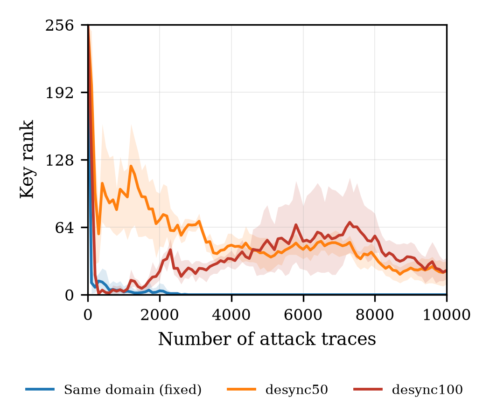
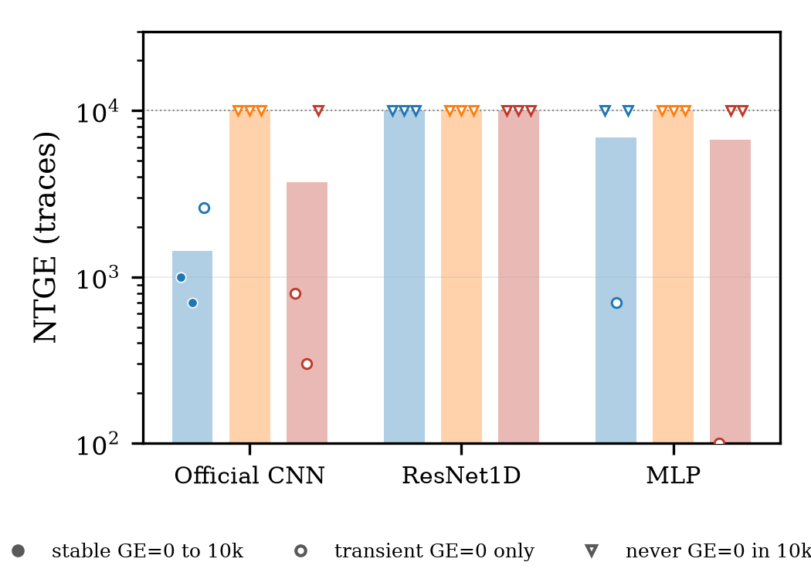
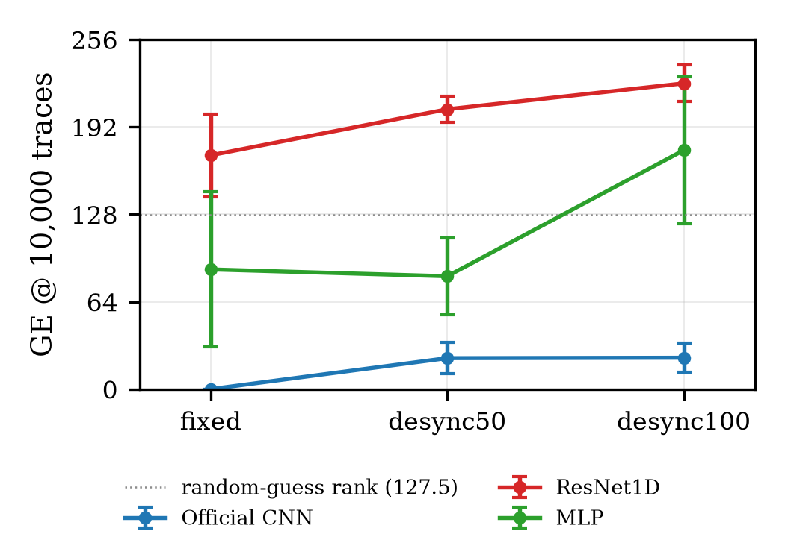

# B-E2 实验报告：三主干在 ASCAD fixed-key → desync50/100 的零适应迁移与主干冻结

**实验编号**：B-E2（成员 B 第二轮）　**执行人**：WBC-cbw　**日期**：2026-11-10

**实验目录**：experiments/02_member_b_method/b_e2_architecture_shift/　**代码版本**：见 manifests/manifest.json 的 git_commit

> 本报告是该实验的正式归档文本（按 docs/research/新人规划.md §8.1 模板）；同目录 README.md 为项目视图版本。本实验为评估型实验：复用 B-E1 的 9 个 Source Only 权重，不训练、不微调。

#### 8.1.1 实验级别

**Formal（评估型）**：3 种主干 × 3 个 seed（42/43/44）× 3 个偏移强度（fixed / desync50 / desync100）= 27 次完整评估。
本实验**不训练、不微调、不做任何适应**：直接加载 B-E1 的 9 个 Source Only 权重（outputs/models/b_e1/<run>/ckpt.pt），在三个数据集各自的 Attack_traces（各 10000 条）上前向推理。
因此本轮没有 pilot，也没有失败重跑；B-E1 的训练仍然是主结果的形式化来源，本实验只改变评估域。

#### 8.1.2 研究问题

1. 在 ASCAD v1 fixed-key 上训练的三个主干，面对 desync50 / desync100 的随机整数时序偏移时，GE 曲线、NTGE、GE@10000、SR 如何变化？
2. 哪一种结构对时序偏移最稳定（以 GE/NTGE 判定，不以 accuracy 判定）？
3. 同域最强的结构，是否跨域也最强？
4. attack accuracy 与 GE 是否一致？能否用 accuracy 代替 GE 做有效性判据？
5. 据此应冻结哪个主干，作为后续 CDAN-SCA 与各 UDA 基线的共享特征提取器？

#### 8.1.3 研究假设

- H1：官方 CNN 的卷积 + 平均池化堆叠对局部平移有一定容忍，退化应小于 MLP 与 ResNet1D；但在 ±100 点随机偏移下可能仍无法在 10000 条内恢复密钥。
- H2：MLP 把 700 维波形当作无序向量，位置敏感，偏移后应迅速退化到随机附近甚至更差。
- H3：ResNet1D 无 BatchNorm、末端 GlobalAvgPool，可能输出接近均匀的概率，GE 接近随机。
- H4：accuracy 会保持在 256 类随机水平附近，无法区分迁移质量。

#### 8.1.4 数据与划分

| 项 | fixed | desync50 | desync100 |
| --- | --- | --- | --- |
| 文件 | D:/sca_project/ASCAD_data/ASCAD.h5 | D:/sca_project/ASCAD_data/ASCAD_desync50.h5 | D:/sca_project/ASCAD_data/ASCAD_desync100.h5 |
| 大小 | 46,566,904 B | 46,566,904 B | 46,566,904 B |
| Profiling_traces | 50000 × 700，int8 | 50000 × 700，int8 | 50000 × 700，int8 |
| Attack_traces | 10000 × 700，int8 | 10000 × 700，int8 | 10000 × 700，int8 |
| metadata desync 分布 | 全 0 | 0–49（50 个值，均值 24.54） | 0–99（100 个值，均值 49.40） |
| source_train | ASCAD.h5 Profiling[0:45000] | 同左（权重训练域固定） | 同左 |
| source_val | ASCAD.h5 Profiling[45000:50000] | 同左 | 同左 |
| target_adapt | **无** | **无** | **无** |
| target_attack | Attack_traces[0:10000] | Attack_traces[0:10000] | Attack_traces[0:10000] |
| 目标字节 | byte = 2 | byte = 2 | byte = 2 |
| 真实密钥字节 | 224 | 224 | 224 |
| 标签定义 | Sbox[pt[2] XOR 224] | 同左 | 同左 |

##### 数据与标签校验（results/verification/dataset_check.json）

- ASCAD h5 的 metadata **没有 label 字段**。攻击集标签由 Sbox[plaintext[:,2] XOR key[0,2]] 现算，与 B-E1 / E0 的标签定义一致。
- Profiling 标签公式核验：三个数据集各 50000 条，mismatch 均为 **0**。
- 攻击集 plaintext 与 key 在三个数据集中**逐元素相同**：差异只在轨迹（时序偏移），攻击样本与真实密钥完全对应。
- 攻击集标签覆盖全部 256 类，每类 23–63 条；desync 不改变标签分布。
- desync 语义核验：对每个 desync 数据集抽样 30 条攻击轨迹，计算其与 fixed 同名轨迹的互相关峰值滞后，与 metadata[desync] 逐个比较——同号平均绝对误差 **0**，30/30 在 ±2 采样点内，峰值相关 0.9999（d50）/ 0.9997（d100），符号为 +1（y[t] ≈ x[t+d]）。因此 desync50/100 可理解为"同一批攻击轨迹、随机整数平移 0–49 / 0–99 点"。
- 轨迹成本口径：没有适应轨迹，所以 N_attack@GE=1 = N_total@GE=1；未达到 GE=0 的 run 按 10000 条截尾记录。

#### 8.1.5 方法与对比

- **方法**：Source Only，零适应。三种主干各自加载 B-E1 权重，直接对目标偏移数据的 Attack_traces 做 256 类 softmax 预测。
- **对比对象**：同一组权重在 fixed / desync50 / desync100 三个评估域上的表现；以及三种主干在同一偏移强度下的横向对比。
- 官方 CNN 直接复用 B-E1 的 OfficialCNN（其内部由 importlib 加载 experiments/00_common_e0/scripts/train_e0_torch.py 的定义），未重写、未改层。
- 评估复用 experiments/cdan-sca-diagnosis/scripts/evaluate_ascad.py 的 ranks()（step=100，byte=2），与 E0/B-E1 同一口径；每个偏移数据集使用自己的 metadata 现算标签。
- 本轮不涉及 CDAN / DANN / CDPA-MMD / AdaBN，也不含任何对抗训练或伪标签。

#### 8.1.6 固定变量与自变量

- 自变量 A：backbone ∈ {mlp, cnn, resnet1d}（来自 B-E1 的受控训练，训练配方完全相同）。
- 自变量 B：评估域偏移强度 ∈ {fixed, desync50, desync100}。
- 固定：9 个已训练权重（不更新）、训练配方（RMSprop lr=1e-5、batch 200、75 epochs、原始 int8 不归一化）、攻击轨迹集合（同一批 10000 条明文/密钥）、目标字节 byte=2、评估代码与 step=100、推理 batch=2000。
- 单变量纪律：对同一 arch × seed，只改变评估域；对同一偏移强度，只改变 backbone。不同时改动训练配方、网络宽度或评估口径。
- 本实验没有新增超参数，因此不存在"调参后重跑"的分支。

#### 8.1.7 运行配置

| 项 | 值 |
| --- | --- |
| seed | 42 / 43 / 44（复用 B-E1 的 9 个 run） |
| 权重 | outputs/models/b_e1/<run>/ckpt.pt（纯 state_dict；共 10 个文件，含 1 个 pilot，833 MB） |
| 优化器 / lr / epochs | 不适用（仅推理；训练配置见 B-E1） |
| 推理 batch | 2000 |
| 精度 | float32，softmax 256 类 |
| GE 评估 | 每个偏移 10000 条 attack，step=100，byte=2 |
| 运行入口 | scripts/run_b_e2_all.py → verify_datasets.py、predict_b_e2.py、evaluate_b_e2.py、aggregate_b_e2.py、plot_b_e2_ge.py |
| 绘图 | MPLCONFIGDIR=<实验目录>/.mplconfig，serif，3.5 in 单栏，300 dpi，PNG + PDF |
| 设备 | NVIDIA RTX 5060 Laptop GPU，PyTorch 2.9.1+cu128，Python 3.12.16 |
| 运行时基线 commit | bc52be4（本实验提交为其后继 commit，见 manifests/manifest.json） |
| 日志 | logs/00_environment.log、logs/01_verify_datasets.log、logs/02_predict_*.log、logs/03_evaluate.log、logs/04_aggregate.log、logs/05_plot.log、logs/run_all_status.log |

#### 8.1.8 指标与成本口径

- **GE / key rank**：每 100 条攻击轨迹记录真实密钥在 256 个候选中的排名（0 = 恢复），Y 轴全量程 0–255。
- **NTGE_first**：GE 首次等于 0 的轨迹数；未达到记 None。
- **NTGE_stable**：从某点起直到 10000 条**一直**保持 GE=0 的最小轨迹数；未达到记 None。用于排除瞬态假恢复。
- **SR@1000 / SR@10000**：该预算处 GE=0 记为成功（逐点口径，因此瞬态恢复在 10000 处可能为 0）。
- **GE@1000 / 5000 / 10000**：对应轨迹预算处的 key rank。
- **attack accuracy**：攻击集 256 类分类准确率，仅辅助。
- **mean max softmax / mean entropy**：攻击集平均最大概率与平均熵（nats），用于观察置信度是否随偏移变化；ln256 = 5.545。
- **成本**：N_total@GE=1 = N_attack@GE=1 + N_adapt@GE=1，本实验 N_adapt = 0；未恢复的 run 报截尾值 10000，并同时给出 NTGE_first 与 NTGE_stable。
- 随机猜测参照：0-based GE 的期望为 127.5。B-E1 文本中的 128.5 是 1-based 表述，二者相差 1，不影响任何比较。

#### 8.1.9 结果

27 次评估全部成功，无缺失、无中断。fixed 的重跑与 B-E1 已有预测逐元素一致：9 个 run 的 max abs diff = 0.0、argmax agreement = 1.0，说明推理链路没有引入偏差。

##### 逐 seed 主结果

**fixed（同域）**

| 结构 | seed | NTGE_first | NTGE_stable | GE@1k | GE@10k | SR@1k | SR@10k | acc (%) | conf | H |
|---|---|---|---|---|---|---|---|---|---|---|
| Official CNN | 42 | 1000 | 1000 | 0 | 0 | 1 | 1 | 0.52 | 0.185 | 3.72 |
| Official CNN | 43 | 700 | 700 | 0 | 0 | 1 | 1 | 0.59 | 0.199 | 3.62 |
| Official CNN | 44 | 2600 | — | 8 | 0 | 0 | 1 | 0.71 | 0.254 | 3.26 |
| MLP | 42 | — | — | 165 | 153 | 0 | 0 | 0.34 | 0.007 | 5.52 |
| MLP | 43 | 700 | — | 5 | 51 | 0 | 0 | 0.43 | 0.007 | 5.53 |
| MLP | 44 | — | — | 46 | 59 | 0 | 0 | 0.40 | 0.007 | 5.52 |
| ResNet1D | 42 | — | — | 78 | 163 | 0 | 0 | 0.30 | 0.005 | 5.54 |
| ResNet1D | 43 | — | — | 84 | 205 | 0 | 0 | 0.32 | 0.005 | 5.54 |
| ResNet1D | 44 | — | — | 64 | 146 | 0 | 0 | 0.30 | 0.005 | 5.54 |

**desync50**

| 结构 | seed | NTGE_first | NTGE_stable | GE@1k | GE@10k | SR@1k | SR@10k | acc (%) | conf | H |
|---|---|---|---|---|---|---|---|---|---|---|
| Official CNN | 42 | — | — | 109 | 32 | 0 | 0 | 0.39 | 0.524 | 1.78 |
| Official CNN | 43 | — | — | 117 | 10 | 0 | 0 | 0.45 | 0.521 | 1.77 |
| Official CNN | 44 | — | — | 63 | 26 | 0 | 0 | 0.35 | 0.636 | 1.32 |
| MLP | 42 | — | — | 60 | 89 | 0 | 0 | 0.40 | 0.318 | 3.05 |
| MLP | 43 | — | — | 20 | 52 | 0 | 0 | 0.39 | 0.258 | 3.22 |
| MLP | 44 | — | — | 105 | 107 | 0 | 0 | 0.38 | 0.258 | 3.32 |
| ResNet1D | 42 | — | — | 226 | 209 | 0 | 0 | 0.36 | 0.006 | 5.53 |
| ResNet1D | 43 | — | — | 227 | 212 | 0 | 0 | 0.29 | 0.006 | 5.53 |
| ResNet1D | 44 | — | — | 199 | 194 | 0 | 0 | 0.34 | 0.005 | 5.54 |

**desync100**

| 结构 | seed | NTGE_first | NTGE_stable | GE@1k | GE@10k | SR@1k | SR@10k | acc (%) | conf | H |
|---|---|---|---|---|---|---|---|---|---|---|
| Official CNN | 42 | 800 | — | 0 | 15 | 1 | 0 | 0.41 | 0.679 | 1.12 |
| Official CNN | 43 | 300 | — | 5 | 19 | 0 | 0 | 0.52 | 0.668 | 1.13 |
| Official CNN | 44 | — | — | 4 | 35 | 0 | 0 | 0.47 | 0.779 | 0.75 |
| MLP | 42 | 100 | — | 130 | 215 | 0 | 0 | 0.42 | 0.330 | 3.04 |
| MLP | 43 | — | — | 107 | 196 | 0 | 0 | 0.36 | 0.260 | 3.25 |
| MLP | 44 | — | — | 48 | 114 | 0 | 0 | 0.42 | 0.253 | 3.36 |
| ResNet1D | 42 | — | — | 205 | 228 | 0 | 0 | 0.31 | 0.006 | 5.53 |
| ResNet1D | 43 | — | — | 221 | 235 | 0 | 0 | 0.33 | 0.006 | 5.53 |
| ResNet1D | 44 | — | — | 152 | 209 | 0 | 0 | 0.31 | 0.005 | 5.54 |

**均值 ± 标准差（每个结构 × 偏移 n=3 seed）**

| 结构 | 偏移 | NTGE_first 截尾均值 ± std | stable | GE@10k 均值 ± std | acc (%) | conf | H |
|---|---|---|---|---|---|---|---|
| Official CNN | fixed | 1433.3 ± 1021.4 | 2/3 | 0.0 ± 0.0 | 0.61 | 0.213 | 3.53 |
| Official CNN | desync50 | 10000.0 ± 0.0 | 0/3 | 22.7 ± 11.4 | 0.40 | 0.560 | 1.62 |
| Official CNN | desync100 | 3700.0 ± 5461.7 | 0/3 | 23.0 ± 10.6 | 0.47 | 0.708 | 1.00 |
| MLP | fixed | 6900.0 ± 5369.4 | 0/3 | 87.7 ± 56.7 | 0.39 | 0.007 | 5.52 |
| MLP | desync50 | 10000.0 ± 0.0 | 0/3 | 82.7 ± 28.0 | 0.39 | 0.278 | 3.20 |
| MLP | desync100 | 6700.0 ± 5715.8 | 0/3 | 175.0 ± 53.7 | 0.40 | 0.281 | 3.22 |
| ResNet1D | fixed | 10000.0 ± 0.0 | 0/3 | 171.3 ± 30.4 | 0.31 | 0.005 | 5.54 |
| ResNet1D | desync50 | 10000.0 ± 0.0 | 0/3 | 205.0 ± 9.6 | 0.33 | 0.006 | 5.53 |
| ResNet1D | desync100 | 10000.0 ± 0.0 | 0/3 | 224.0 ± 13.4 | 0.32 | 0.006 | 5.53 |

- NTGE_first 的截尾均值把未达成的 run 记为 10000，仅用于排序；是否真正恢复以 NTGE_stable 与 GE@10000 为准。
- Official CNN 在 fixed 下 3/3 达到 GE=0，其中 2/3 稳定；desync100 下 2/3 出现首次 GE=0（800 / 300 条），但都在 10000 条内回升，stable 0/3。
- 交叉偏移下（desync50 与 desync100 合计 18 次评估）**没有任何一次达到稳定 GE=0**。

##### 图

- 每个结构一张三偏移 GE 对比（线性 + 对数，seed min–max 带 + 均值线）：
  - figures/b_e2_ge_cnn.png / .pdf、figures/b_e2_ge_cnn_log.png / .pdf
  - figures/b_e2_ge_resnet1d.png / .pdf、figures/b_e2_ge_resnet1d_log.png / .pdf
  - figures/b_e2_ge_mlp.png / .pdf、figures/b_e2_ge_mlp_log.png / .pdf
- NTGE 矩阵（柱为 3-seed 截尾均值，点标记逐 seed 状态：实心 = 稳定 GE=0，空心圆 = 仅瞬态，倒三角 = 未达成）：figures/b_e2_ntge_matrix.png / .pdf
- GE@10000 随偏移强度退化图（均值 ± std，含随机参照线 127.5）：figures/b_e2_ge10000_vs_shift.png / .pdf

##### 攻击成本

- 无适应轨迹：N_attack@GE=1 = N_total@GE=1 = NTGE（对未恢复的 run 报截尾 10000）。
- 27 次推理合计 15.94 s GPU 时间（fixed 5.56 s、desync50 5.21 s、desync100 5.17 s），对应 270000 条轨迹；推理成本相对于 B-E1 的训练成本（9658 s）可忽略。
- 本实验不产生新的模型 checkpoint，复用 B-E1 的 833 MB 权重归档。

#### 8.1.10 结果解释

##### （1）官方 CNN：唯一保持信息量的结构，但偏移下也从"恢复"退化为"部分排序"

- 同域 fixed：GE@10000 = 0（3/3），NTGE_first = 700 / 1000 / 2600，与 B-E1 完全一致。
- desync50：GE@10000 = 32 / 10 / 26（均值 22.7 ± 11.4），GE 从 1000 条的约 96 一路降到 10000 条的 10–32，但从未到 0。
- desync100：GE@10000 = 15 / 19 / 35（均值 23.0 ± 10.6），**轨迹形状与 desync50 不同**：1000 条处 GE 已经是 0 / 5 / 4，两个 seed 在 800 / 300 条首次到 0，随后回升到 15–35。
- 也就是说，两个偏移强度下最终的 GE@10000 几乎相同（22.7 vs 23.0），但 desync100 的早期低 rank 是**瞬态**：NTGE_first 会把它记成 300–800 条就成功，而 stable 口径显示 0/3 成功。这是本实验最重要的口径教训之一。
- 机制假设（未逐条验证）：desync 是逐轨迹随机整数平移，泄漏点在 700 点窗口中的位置随轨迹变化；CNN 的卷积 + 5 次平均池化提供了部分平移容忍，但仍不足以完全对齐。desync100 的早期 GE=0 可能是"部分轨迹恰好对齐 + 高置信度"造成的短程累积，随着轨迹增多，系统性错位的证据重新占优。

##### （2）MLP：从随机附近退化为"自信地错"

- GE@10000：fixed 87.7 ± 56.7 → desync50 82.7 ± 28.0 → desync100 175.0 ± 53.7。desync50 下仍在随机附近，desync100 下**系统性高于随机**。
- 置信度反向变化：mean max softmax 0.007 → 0.278 → 0.281，平均熵 5.52 → 3.20 → 3.22 nats（上限 5.545），而 accuracy 始终 0.36%–0.43%（随机 0.391%）。
- 解读：MLP 把 700 维波形当作无序向量，偏移后输入落在训练分布之外；它给出的高置信度预测与真实密钥无关，属于典型的 confident wrong。对后续熵加权方法是直接风险信号（见（6））。

##### （3）ResNet1D：概率近均匀，却系统性地把真钥排到后段

- GE@10000：fixed 171.3 ± 30.4 → desync50 205.0 ± 9.6 → desync100 224.0 ± 13.4，三个 seed 全部高于随机参照，且随偏移单调变差。
- 输出几乎均匀：mean max softmax ≈ 0.005–0.006，平均熵 5.534–5.540 nats（ln256 = 5.545），accuracy 0.29%–0.36%（与随机的差约 1–2 个标准误，不构成显著低于随机）。
- 但 GE 在 9 个 run 上一致地高于随机 → 不是"没有信息"，而是存在一个极小的、系统性的错误偏置；单条轨迹上看不出，10000 条累积后把真钥推到候选列表后段。其失败模式与 MLP 相反：MLP 是自信地错，ResNet1D 是"均匀地错"。

##### （4）稳定性排序与"同域最强 = 跨域最强"

- 按 GE@10000 均值：CNN（0 / 22.7 / 23.0）< MLP（87.7 / 82.7 / 175.0）< ResNet1D（171.3 / 205.0 / 224.0）。
- 按相对自身同域基线的退化：CNN +22.7 / +23.0；MLP −5.0 / +87.3；ResNet1D +33.7 / +52.7。三种排序一致指向 CNN。
- 只有 CNN 在两种偏移下都显著低于随机线（GE@10000 约为随机期望的 18%），也只有 CNN 在偏移下出现过 GE=0（虽然是瞬态）。
- 因此：**同域最强的结构，跨域也最强**；B-E1 的结论在零适应迁移下继续成立。

##### （5）accuracy 与 GE 不一致，不能作为有效性判据

- 27 个 run 的 attack accuracy 全部落在 0.29%–0.71%，而 GE@10000 覆盖 0–235。CNN 同域 accuracy 仅 0.607%，却能把密钥排到第 1；ResNet1D 的 accuracy 0.31% 与随机 0.39% 的差约 1.3 个标准误，但 GE 稳定高于随机。
- 汇总相关：27 个 run 上 Pearson(acc, GE@10000) = −0.718，Spearman = −0.758；但这主要由结构间差异驱动（CNN 同时 accuracy 最高、GE 最低）。
- 结构内相关方向不一致：CNN −0.70（n=9），ResNet1D +0.328，MLP −0.322。ResNet1D 内部甚至是"accuracy 越高、GE 越差"。
- 最直接的例子：CNN desync50 seed 42 的 accuracy = 0.39%（恰为随机），GE@10000 = 32（有信息）；MLP desync100 seed 42 的 accuracy = 0.42%（略高于随机），GE@10000 = 215（比随机差）。相同量级的 accuracy，相反的结论。
- 结论：accuracy 只能说明 256 类分类器是否在训练集/同域上过拟合，不能说明密钥排序是否有效；本项目继续以 GE/NTGE/SR 为唯一有效性判据。

##### （6）置信度反向与熵加权的风险（对 B-E3 的直接影响）

- CNN 的 mean max softmax 随偏移从 0.213（fixed）升到 0.560（d50）、0.708（d100），平均熵从 3.53 降到 1.62、1.00，但 accuracy 从 0.607% 降到 0.397%、0.467%——**越偏移越自信，且自信与正确性脱钩**。
- 仓库 legacy CDAN 实现的熵加权为 w = 1 + exp(−H)（experiments/legacy/CDAN/dann.py:110-114），低熵目标样本权重更高；主方法文档也明确要求检验 confident wrong（docs/research/主方法.md:57）。
- 在本实验观察到的偏移条件下，低熵主要对应"自信地错"，直接使用熵加权可能放大错误样本的对抗梯度。B-E3 必须把这一点作为显式风险：至少对比"原始熵加权 / 温度校准后加权 / 权重截断"三种设置，并报告 ECE 与 confident-wrong 比例。

#### 8.1.11 失败、限制与异常

| 编号 | 现象 | 处置 | 是否影响主结论 |
| --- | --- | --- | --- |
| F1 | 18 次跨偏移评估（desync50 + desync100）全部未达到稳定 GE=0 | 如实记录；结论只声称"部分排序能力"，不声称恢复 | 否；这正是 UDA 的动机 |
| F2 | 5 个 run 出现 NTGE_first 但非稳定（瞬态） | 双口径报告；表中 NTGE_stable 记 — | 否；但说明只看 NTGE 会高估 |
| F3 | 容量混淆：CNN 66.65M 参数，MLP 0.75M，ResNet1D 1.51M | B-E1 的 pilot 显示 MLP 连 2000 条都拟合不了、ResNet1D 提高 lr 后 GE 从 146–205 降到 54，说明容量不是唯一原因；但仍不是受控容量实验 | 是（结论限定为"本配方/本容量配置下"） |
| F4 | CNN 同域 NTGE 在 seed 间 700–2600 波动 | 报均值 ± std；不把单 seed 数值当作结构常数 | 否 |
| F5 | h5 metadata 无 label 字段 | 用 Sbox 公式现算；三重校验（profiling 50000 条 0 mismatch、三数据集 plaintext/key 逐元素相同、desync metadata 与互相关滞后一致） | 否 |
| F6 | ops_bash 工具在本机不可用（EXECUTOR_UNAVAILABLE） | 改用 Python 子进程编排 scripts/run_b_e2_all.py，日志与结果不受影响 | 否 |
| F7 | 本实验是零适应，未使用任何 target 标签或适应轨迹 | 结果应视为 UDA 方法的下界参照，不是 UDA 效果 | 否 |

##### 瞬态 NTGE 清单

| run | 偏移 | NTGE_first | GE=0 点数 | GE@10000 |
| --- | --- | --- | --- | --- |
| cnn_s44 | fixed | 2600 | 74 | 0 |
| mlp_s43 | fixed | 700 | 3 | 51 |
| cnn_s42 | desync100 | 800 | 2 | 15 |
| cnn_s43 | desync100 | 300 | 1 | 19 |
| mlp_s42 | desync100 | 100 | 2 | 215 |

cnn_s44 的 fixed 结果较特殊：GE 在 2600 条首次到 0，之后 74 个评估点中大部分为 0、末点也为 0，但中间有回升，因此 stable 口径判为未稳定。它说明"稳定"判据偏严格，但也正因如此才不会被瞬态误导。

#### 8.1.12 结论边界

- 适用范围：ASCAD v1 fixed-key（byte=2，ID 模型，256 类）→ ASCAD_desync50 / desync100 的**均匀随机整数平移**（0–49 / 0–99 点），10000 条攻击轨迹，三种指定主干与官方训练配方。
- 不声称 CNN 在任何数据集、任何偏移模型上都最优；不声称 ResNet1D/MLP 在其它配方（如 BatchNorm、标准化、更大 lr）下也失败——B-E1 的 pilot 已显示 ResNet1D 提 lr 会明显改善。
- 不声称熵加权一定失效：本实验只证明在 CNN 上"低熵 ≠ 正确"，因此 B-E3 需要显式检验，而不是直接假定有效。
- 不涉及跨设备（不同芯片/板卡）或电子噪声域偏移；desync 只改变时序对齐。
- 结论基于 3 个 seed；NTGE 的 seed 间波动较大（CNN 同域 700–2600），所有均值都附带标准差。

#### 8.1.13 主干冻结决定与下一步

##### 冻结决定

**后续所有实验（B-E3 起的 CDAN-SCA、DANN、CDAN、CDPA-MMD、AdaBN）统一使用 Official CNN 作为特征提取器主干。**

| 冻结项 | 值 |
| --- | --- |
| 主干 | Official CNN（Conv1D 64/128/256/512/512，k=11，每层 AvgPool，Flatten → Dense4096 → Dense4096 → 256） |
| 参数量 | 66,652,544 |
| 输入 | (N, 1, 700)，原始 int8 幅度转 float32，不归一化 |
| 训练配方 | RMSprop lr=1e-5，batch 200，75 epochs（沿用 E0/B-E1） |
| 目标字节 / 类别 | byte=2，256 类 ID 模型 |
| 适用实验 | 全部后续同域与 UDA 实验；若需更换主干，必须作为独立消融并说明理由 |

##### 理由（按 NTGE/GE 的均值与稳定性，不按 accuracy）

1. **同域唯一能恢复密钥**：fixed 下 3/3 达到 GE=0，2/3 稳定，NTGE_first 均值 1433；MLP 与 ResNet1D 均 0/3 稳定。
2. **跨偏移唯一保持信息量**：desync50/100 的 GE@10000 为 22.7 ± 11.4 / 23.0 ± 10.6，远低于随机 127.5；MLP 为 82.7 / 175.0，ResNet1D 为 205.0 / 224.0。
3. **seed 稳定性**：CNN 在两个偏移下的 GE@10000 标准差为 11.4 / 10.6；MLP 为 28.0 / 53.7；ResNet1D 虽为 9.6 / 13.4，但其均值在 205–224（低方差围绕坏均值，不能单独作为稳定性证据）。判断稳定性时必须同时看均值与方差。
4. **唯一在偏移下出现过 GE=0 的结构**（desync100，800 / 300 条，虽为瞬态），说明它仍保留部分可利用的密钥相关信息。
5. **不以 accuracy 为依据**：27 个 run 的 accuracy 均在 0.29%–0.71%（随机 0.391%），无法区分 0 与 235 的 GE 差异；若按 accuracy 选型会得到错误结论。

##### 容量混淆的声明

CNN 参数量是 MLP 的 88.6 倍、ResNet1D 的 44.3 倍。本实验不能把"CNN 更好"完全归因于结构归纳偏置；B-E1 的 pilot（MLP 连 2000 条都拟合不了、ResNet1D 提 lr 后 GE 明显下降）说明优化条件与结构匹配也占相当比重，但这是**旁证而非受控实验**。后续如需严谨归因，应补充"同参数量/同感受野"的受控消融，本轮不展开。

##### 下一步实验

1. **B-E3：CDAN-SCA（CNN 主干，fixed → desync50）**。3 个 seed；把 Attack_traces 明确拆成 target_adapt 与 target_attack 两部分（不得混用），同时报告 N_attack@GE=1 与 N_total@GE=1。
2. **熵加权风险检验**：对比原始 w = 1 + exp(−H)、温度校准后加权、权重截断三种设置；报告 ECE、confident-wrong 比例与 GE，验证"低熵是否等于高可信"。
3. **诊断分析**：ECE、confident wrong 比例、t-SNE、类内/类间距离，用于解释适应前后 GE 变化。
4. **更难设置**：desync100 作为 stress test；若 desync50 已能区分方法，再扩展到 desync100。
5. **口径固定**：后续报告一律同时给出 NTGE_first、NTGE_stable、GE@10000、SR，以及 N_attack 与 N_total 两种成本；不允许只报 NTGE_first。
