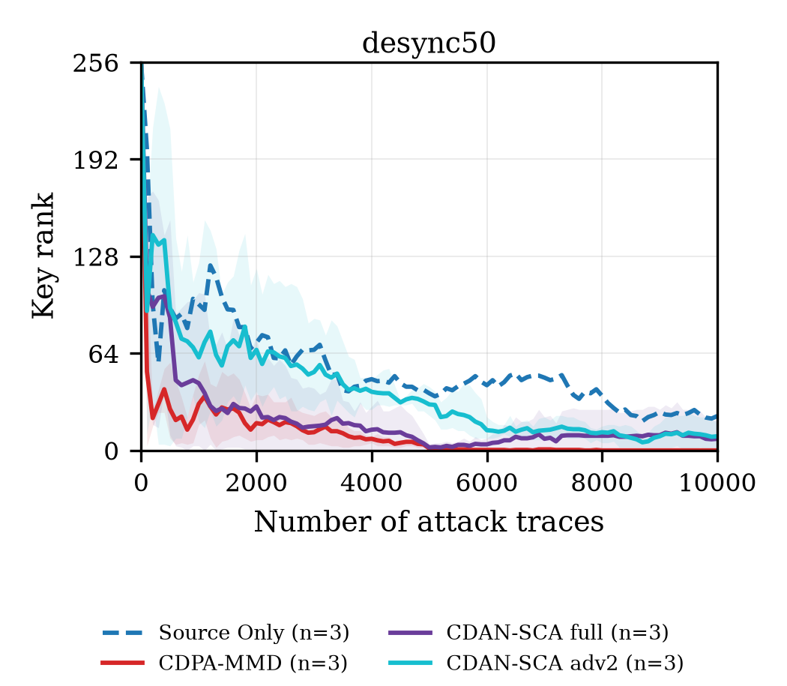
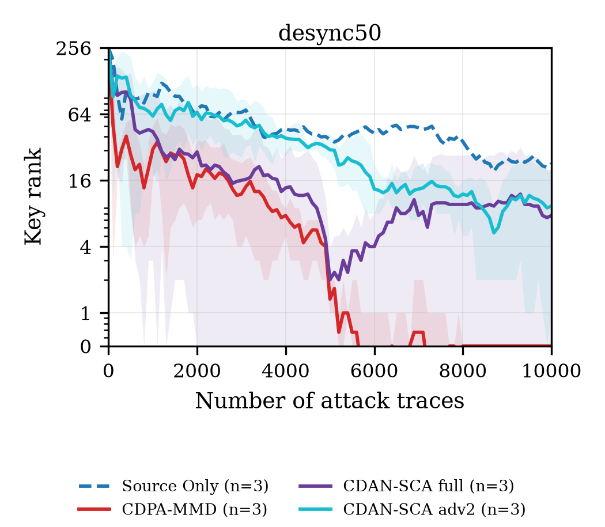
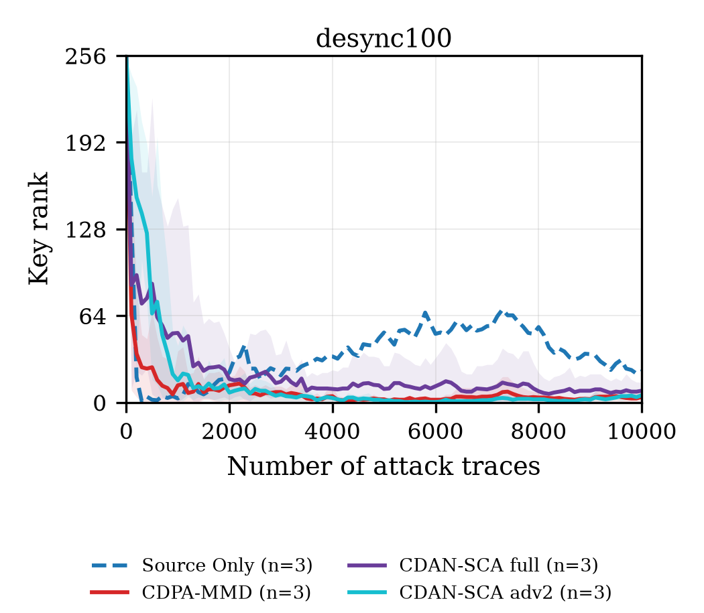
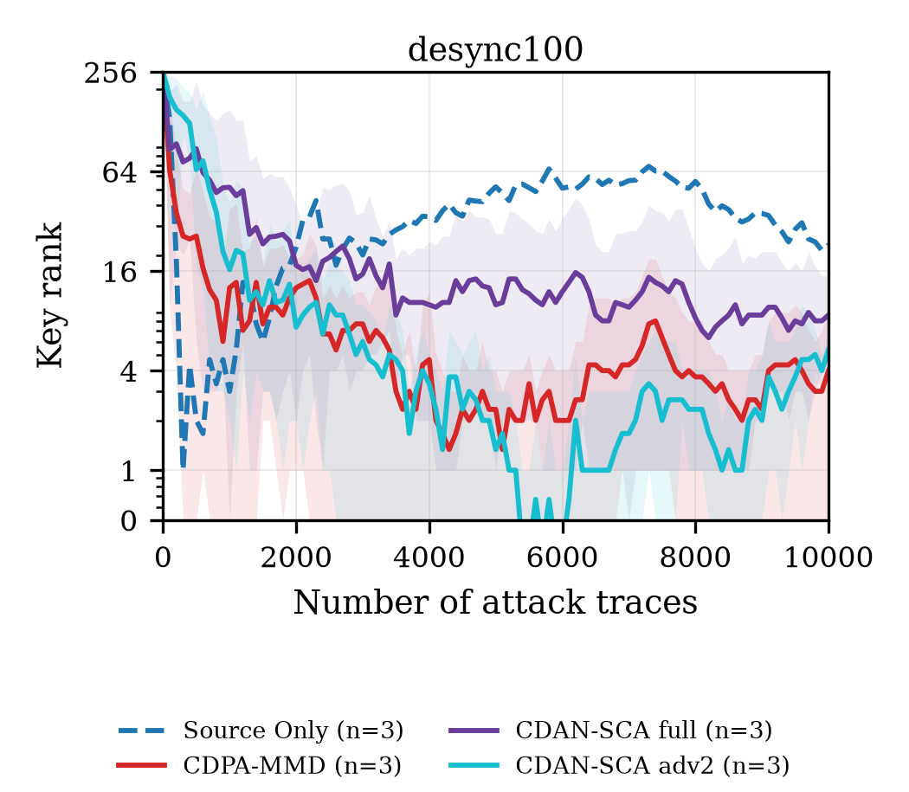
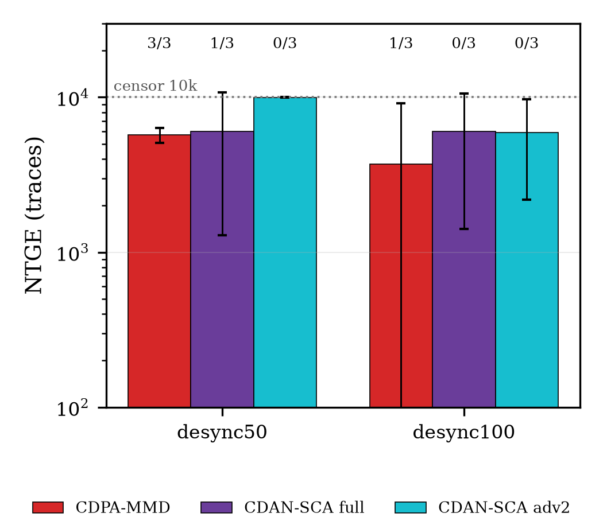
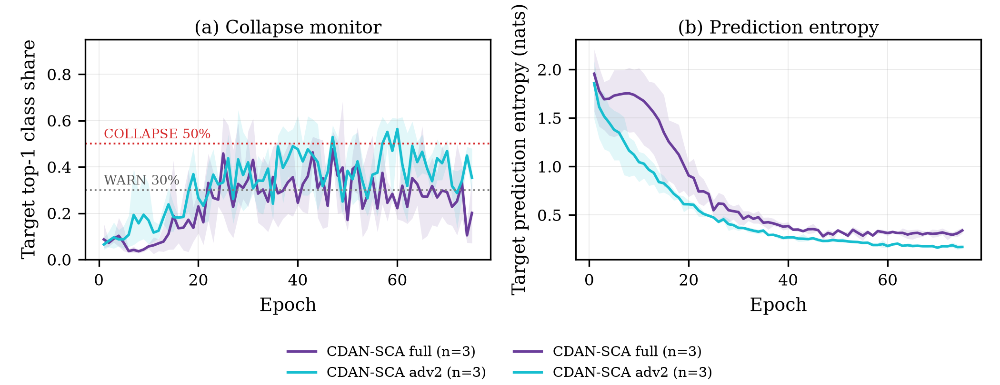
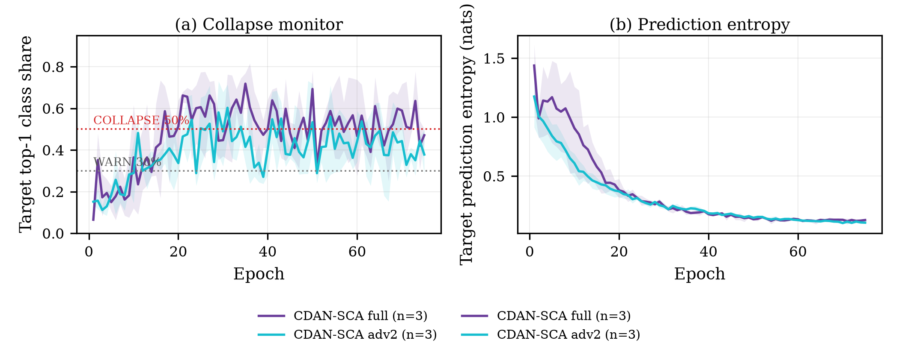

# B-E3 补充实验：CDAN-SCA 对抗稳定性改造（adv2）

> 本报告由 scripts/make_report_adv2.py 从 results/ 的 JSON 机械生成，数字与 summary_adv2.json 一致。

#### 8.1.1 实验级别与矩阵

级别：**pilot→formal 补充**（在 B-E3 正式实验之后，针对“对抗项负迁移”做的一次结构性改造验证）。
矩阵：CDAN-SCA adv2 × {desync50, desync100} × seeds {42,43,44} = 6 run；每 run 75 epoch、batch 200、RMSprop lr=1e-5、原始 int8 输入；划分与 B-E3 完全一致（source_train 45k / source_val 5k / target_adapt 45k / target_attack 10k）。
对照：CDPA-MMD（A-E3）、CDAN-SCA full（B-E3）、Source Only（B-E2），同划分、同评估脚本、同 NTGE 口径。

#### 8.1.2 假设

- H1：原 full 的失效主因是条件判别器 + 熵权重把“自信但错”的目标样本对齐，导致预测坍塌；压制坍塌应改善 GE。
- H2：判别器过强/过早饱和（d_acc 0.86–0.92）使 GRL 梯度成为噪声，需阻止其进入分类头。
- H3：只做一致性门控会引入选择偏差，判别器必须同时看到完整目标分布。

#### 8.1.3 数据划分

与 B-E3 逐条一致：source_train = ASCAD fixed Profiling[0:45000]；source_val = [45000:50000]；target_adapt = desync Profiling[0:45000]（无标签）；target_attack = desync Attack[0:10000]（与适应集不重叠，仅评估）。

#### 8.1.4 方法改动（相对 B-E3 full）

1. 条件输入 detach：g = softmax(logits.detach())，对抗梯度不再直接改写分类头。
2. 一致性硬门控：目标批两次轻增广（roll ±8、幅度 ±5%、噪声 0.01σ），仅两视图 argmax 一致的样本进入生成器侧对抗项；keep_frac < 0.05 时回退全批。
3. 判别器全批辅助损失（aux_full=0.5）：在完整目标批（特征与条件都 detach、不过 GRL）上再算一次判别器 BCE，消除门控选择偏差。
4. 目标域先验 EMA → KL(p̄‖uniform) = log256 − H(p̄)，权重 0.3。
5. λ 斜坡 20 epoch（λ_eff = 0.1·min(1, epoch/20)）、域标签平滑 0.1、梯度裁剪 5.0、判别器 lr 倍率 1.0。

#### 8.1.5 训练成本

已完成 6 个 run，训练合计 13,650 s = 3.79 GPU·h；单 run 约 37.9 min（约 31.6 s/epoch，比 full 慢约 20%）。

#### 8.1.6 结果

**desync50**

| 方法 | n | NTGE 首触 (mean±std) | 稳定 NTGE | 稳定率 | GE@1k | GE@10k | N_total | max top1 | collapse ep |
|---|---|---|---|---|---|---|---|---|---|
| Source Only | 3 | 10000±0 | 10000 | 0/3 | 96.33 | 22.67±11.37 | 10000 | 0.000 | 0.0 |
| CDPA-MMD | 3 | 5700±624 | 6333 | 3/3 | 30.67 | 0.00±0.00 | 50700 | 0.000 | 0.0 |
| CDAN-SCA full | 3 | 6000±4716 | 7333 | 1/3 | 44.33 | 7.67±10.79 | 51000 | 0.610 | 5.7 |
| CDAN-SCA adv2 | 3 | 9967±58 | 10000 | 0/3 | 61.33 | 9.33±9.07 | 54967 | 0.627 | 12.7 |

**desync100**

| 方法 | n | NTGE 首触 (mean±std) | 稳定 NTGE | 稳定率 | GE@1k | GE@10k | N_total | max top1 | collapse ep |
|---|---|---|---|---|---|---|---|---|---|
| Source Only | 3 | 3700±5462 | 10000 | 0/3 | 3.00 | 23.00±10.58 | 3700 | 0.000 | 0.0 |
| CDPA-MMD | 3 | 3700±5462 | 9233 | 1/3 | 12.67 | 4.00±4.58 | 48700 | 0.000 | 0.0 |
| CDAN-SCA full | 3 | 6000±4583 | 10000 | 0/3 | 51.33 | 8.67±5.51 | 51000 | 0.791 | 35.3 |
| CDAN-SCA adv2 | 3 | 5933±3754 | 10000 | 0/3 | 16.33 | 5.33±1.53 | 50933 | 0.725 | 17.7 |

逐 run（adv2）：

| run | NTGE 首触 | 稳定 | GE@1k | GE@10k | SR@10k | max top1 | COLLAPSE ep | 训练秒 |
|---|---|---|---|---|---|---|---|---|
| cdan_sca_adv2_desync100_s42 | 2600 | — | 2 | 4 | 0.00 | 0.731 | 16 | 2256 |
| cdan_sca_adv2_desync100_s43 | — | — | 5 | 7 | 0.00 | 0.715 | 13 | 2267 |
| cdan_sca_adv2_desync100_s44 | 5200 | — | 42 | 5 | 0.00 | 0.732 | 24 | 2228 |
| cdan_sca_adv2_desync50_s42 | — | — | 41 | 19 | 0.00 | 0.613 | 6 | 2372 |
| cdan_sca_adv2_desync50_s43 | 9900 | — | 19 | 1 | 0.00 | 0.645 | 17 | 2262 |
| cdan_sca_adv2_desync50_s44 | — | — | 124 | 8 | 0.00 | 0.622 | 15 | 2265 |

#### 8.1.7 图

#### 8.1.8 坍塌与校准

- desync50：adv2 max top1 0.627、COLLAPSE 12.7 epoch；full 为 0.610 与 5.7 epoch；adv2 平均预测熵 0.200 nats，full 0.364。
- desync100：adv2 max top1 0.725、COLLAPSE 17.7 epoch；full 为 0.791 与 35.3 epoch；adv2 平均预测熵 0.118 nats，full 0.140。

关键观察：冒烟（12 epoch、6k 子集）中 adv2 全程未坍塌，但全量 75 epoch 下仍出现 COLLAPSE——坍塌发生在 epoch 20 之后，短期冒烟看不到，因此“冒烟不塌”不能当作稳定性证据。

#### 8.1.9 置换检验（轨迹顺序稳健性）

| run | 原始 NTGE | 置换均值±std | 区间 | 复现情况 |
|---|---|---|---|---|
| cdan_sca_adv2_desync50_s42 | — | — | — | 10k 内无 GE=0，跳过 |
| cdan_sca_adv2_desync50_s43 | 9900 | 5500±3469 | [100, 10000] | 9/10 次不慢于原始 |
| cdan_sca_adv2_desync50_s44 | — | — | — | 10k 内无 GE=0，跳过 |
| cdan_sca_adv2_desync100_s42 | 2600 | 9070±2146 | [3500, 10000] | 0/10 次不慢于原始 |
| cdan_sca_adv2_desync100_s43 | — | — | — | 10k 内无 GE=0，跳过 |
| cdan_sca_adv2_desync100_s44 | 5200 | 7980±3627 | [600, 10000] | 2/10 次不慢于原始 |

#### 8.1.10 失败与异常记录

- 2026-11-23 21:24 暂停：队列在 desync50_s44 第 3 epoch 被按 PID 终止（无 ckpt，恢复后从头重跑）；2026-11-24 13:42 恢复，自动跳过已完成的 s42/s43。
- 首版监控图把中断残段（s44 的 3 epoch）计入 seed 带，曲线只画到 3 epoch；已改为只接受 ≥70 epoch 的完整 run。
- adv2 的 d_tgt 训练日志只在门控子集上统计，不能与全量 eval 直接比较（早前 v1 因此误判判别器已对齐）。

#### 8.1.11 结论与边界

- desync50：adv2 NTGE 首触 9967±58、稳定率 0/3、GE@10k 9.33；对照 full 6000/1/3、CDPA 5700/3/3。
- desync100：adv2 NTGE 首触 5933±3754、稳定率 0/3、GE@10k 5.33。
- 判定：按任务书硬判据（d50 NTGE≤5700 且 3/3 稳定；d100 GE@10k≤4.0 且 NTGE≤3700），verdict 见上表；若为 not-win，结论是“对抗项的稳定性改造未转化为 key rank 收益”。
- 边界：3 seed、10k 截尾、单一 fixed-key 源域、仅 desync 两种偏移；不覆盖跨设备与可变密钥。

#### 8.1.12 对论文初稿的影响

初稿 8.1 节把失效机制归为“熵权重早期趋 1 + 条件判别器放大自信错误 + 对抗与分类梯度冲突”。adv2 修掉了后两点（detach 条件、梯度裁剪、全批判别器），GE 仍未改善，说明第一点（熵权重随置信度上升放大对抗项）是更主要的驱动；这与 B-E5 一致：校准/稳定指标好转不等于 key rank 好转。

#### 8.1.13 下一步

1. 把对抗权重与置信度解耦（w 上限 0.5 或 w²），再测 6 run。
2. 只在 conv 层做对抗（fc1/fc2 不接 GRL），验证高层特征被对抗破坏的假设。
3. 用少样本档（50/500）复测 adv2——C-E4 显示 CDPA 在该档 3/3 稳定、full 0/3，最可能体现方法差异。
4. 若三条都不改善，把结论固化为“对抗项在本任务上为负资产”，主方法转向校准 + 少样本对齐。

