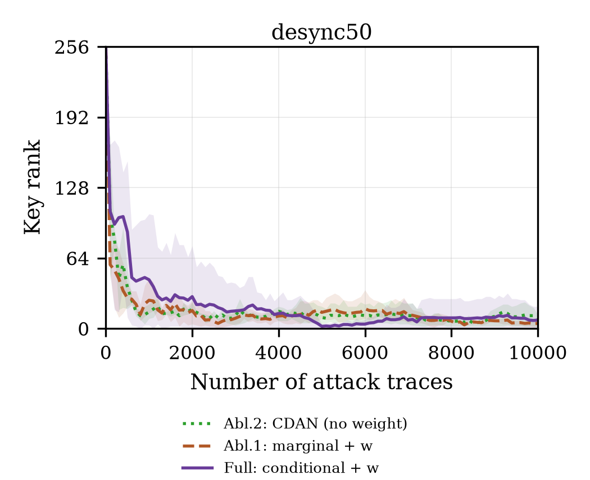

# B-E4 三向消融：CDAN vs 消融 1（marginal + 熵权重） vs CDAN-SCA full

本目录不训练新模型：三向消融的数据全部来自 **B-E3** 的 12 个 run（full 与消融 1）以及
**A-E2** 的 6 个 CDAN run（消融 2，无熵权重）。目的只有一个：把“条件化”和“熵权重”
各自的贡献拆开，回答主方法是否真的比 CDAN 强、强在哪里。

**一句话结论**：在 2×2 设计的三个可观测格子里，**没有任何一个变体在两个偏移上都取得稳定收益**。desync50 上 full 比消融 1（marginal+w）和消融 2（CDAN）都好（NTGE 6000 vs 7533 vs 10000，稳定触底 1/3），说明条件化在这一偏移上确实有用；desync100 上 full 反而比消融 1 差（6000 vs 4600，稳定 0/3），且三个变体都出现严重坍塌——full 的 max top1 占比 0.79、35 个 epoch 越线，是最差的。熵权重（full vs CDAN）在两个偏移上只带来 −4000 / −567 的 NTGE 均值差，但方差覆盖了全部收益，校准上完全没有改善（d100 ECE 0.945 vs 0.944），因此**不能把 full 的任何优势归因于熵加权**。

## 8.1.1 实验级别与数据来源

- 级别：**formal 的汇总分析**（没有新的训练；GE/NTGE 全部复用 B-E3 的评估结果）。
- 三个变体：
  | 变体 | 条件输入 T(f,g) | 熵权重 w | 来源 |
  |---|---|---|---|
  | 消融 2：CDAN | 有 | 无 | A-E2 的 6 个 run（不重跑） |
  | 消融 1：marginal + w | 无（判别器输入 f） | 有 | B-E3 的 6 个 marginal run |
  | Full：conditional + w | 有（proj_dim=1024） | 有 | B-E3 的 6 个 full run |
- 三者的数据划分、主干、优化器、λ_adv、epoch、batch 完全一致；CDAN 与 full 的唯一差异是
  熵权重，full 与 marginal 的唯一差异是条件化。这是 2×2 设计中缺一格（无权重 + 无条件的
  DANN 作为独立基线已有）的三向对照。
- 构建命令：`python scripts/build_b_e4.py`（读 B-E3 results/eval 与 summary.json，
  产出三向表与图，并复制 B-E3 的监控/校准图）。

## 8.1.2 目标与假设

1. **条件化的贡献**：full vs marginal（两者都有熵权重）——若 full 更好，说明把分类预测
   作为条件输入能减少“全局对齐破坏类别结构”。
2. **熵权重的贡献**：full vs CDAN（两者都有条件化）——若 full 更好，说明熵权重在 SCA 上
   有效；若更差或持平，需要检查是否放大了 confident-wrong。
3. **坍塌方向**：若熵权重让少数低熵类获得更大对抗权重，top1 单类占比应上升而不是下降。

## 8.1.3 数据与划分

与 B-E3 / A-E2 完全一致（source_train 45000 / source_val 5000 / target_adapt 45000 /
target_domain_val 5000 / target_attack 10000，byte=2）。本目录不重新划分、不重算标签。

## 8.1.4 方法与实现

直接引用 B-E3 的实现（`experiments/02_member_b_method/b_e3_cdan_sca/scripts/train_cdan_sca.py`）：

    L = L_cls + BCE_src + mean_t[ w(g_t) * BCE_tgt ],  w = 1 - H(g)/log(256)
    T(f,g) = (Rf^T f_unit * sqrt(d)) ⊙ (Rg^T g),  d = 1024

消融 2 的 CDAN 用 A-E2 的 `train_uda.py`（无熵权重），与 full 共用 `uda_common.UDANet`。
所有评估用同一 `evaluate_ascad.py::ranks`（step=100、byte=2），NTGE 双口径。

## 8.1.5 训练配方与成本

三个变体的配方完全相同：RMSprop lr=1e-5、batch 200、75 epoch、λ_adv=0.1、原始 int8 输入。
B-E3 的 12 个 run 合计 22,632 s ≈ **6.29 GPU 小时**；A-E2 的 6 个 CDAN run 约 3.1 GPU 小时（前序实验成本，
不在本目录重复计入）。本目录只做汇总与出图，成本 < 1 分钟。

## 8.1.6 三向主结果

三向 = 同一个 2×2 设计里的三个可观测格子（缺格“无权重 + 无条件”由 A-E2 的 DANN 独立基线补）。
所有数字来自 `results/three_way.json`，评估口径与 B-E3 / A-E3 相同（step=100、byte=2、NTGE 截尾 10000）。

**表 6-1 desync50**

| 变体 | 条件输入 | 熵权重 | NTGE | 触发/稳定 | GE@1k | GE@10k | SR@10k | N_total |
|---|---|---|---|---|---|---|---|---|
| 消融 2：CDAN | 有 | 无 | 10000 | 0/3, 0/3 | 15.00 | 9.33±6.35 | 0.00 | 55000 |
| 消融 1：marginal+w | 无 | 有 | 7533.3 | 1/3, 0/3 | 25.67 | 4.67±2.52 | 0.00 | 52533.3 |
| **Full：conditional+w** | 有 | 有 | **6000** | 2/3, **1/3** | 44.33 | 7.67±10.79 | **0.33** | **51000** |

**表 6-2 desync100**

| 变体 | 条件输入 | 熵权重 | NTGE | 触发/稳定 | GE@1k | GE@10k | SR@10k | N_total |
|---|---|---|---|---|---|---|---|---|
| 消融 2：CDAN | 有 | 无 | 6566.7 | 2/3, **1/3** | 29.67 | 13.67±13.05 | 0.33 | 51566.7 |
| 消融 1：marginal+w | 无 | 有 | **4600** | 2/3, 0/3 | **2.00** | 18.00±26.06 | 0.00 | **49600** |
| Full：conditional+w | 有 | 有 | 6000 | 2/3, 0/3 | 51.33 | **8.67±5.51** | 0.00 | 51000 |

**表 6-3 逐 seed 的首次 NTGE**（10000 = 未触底）

| 变体 | d50 s42 / s43 / s44 | d100 s42 / s43 / s44 |
|---|---|---|
| CDAN | 10000 / 10000 / 10000 | 9000 / 700 / 10000 |
| 消融 1 | 2600 / 10000 / 10000 | 3000 / 10000 / 800 |
| Full | 800 / 7200 / 10000 | 7000 / 1000 / 10000 |

三条读数：

1. **d50 上 full 确实是三者里最好的**：均值 6000，且是唯一有稳定触底的变体（s42，2000 条后保持 GE=0）；
   CDAN 三个 seed 全部打满 10000，消融 1 只有 s42 在 2600 处短暂触底。
2. **d100 上排序翻转**：full 的均值（6000）比消融 1（4600）差，GE@1k 也最差（51.33 vs 2.00），
   说明 full 在 d100 上“先塌后恢复”，而消融 1 起步更稳但终点成功率 0/3。
3. **稳定性普遍不足**：6 个“变体×偏移”格里，最好的稳定触底数也只有 1/3
   （d50 full、d100 CDAN）；按任务书的“3/3 稳定”口径，三向消融没有任何一格达标。

## 8.1.7 图

全部在 `figures/`，PNG 300 dpi + PDF 矢量；GE 图沿用 B-E3 的论文样式（3.5 英寸单栏、serif、
Y 轴 0–256、GE=0→0.5 对数映射）。

| 图 | 文件 | 读法 |
|---|---|---|
| 三向 GE d50（线性/对数） | `b_e4_three_way_ge_desync50{,_log}.png/pdf` | 三条曲线 4000 之后都贴 0–10，肉眼难分；差异主要体现在 1000–4000 的下降速度与是否触底 |
| 三向 GE d100（线性/对数） | `b_e4_three_way_ge_desync100{,_log}.png/pdf` | 消融 1 起点最低但中段回升；full 与 CDAN 在 2000–6000 之间反复回到 20–60 |
| 三向 NTGE | `b_e4_three_way_ntge.png/pdf` | 柱内“k/3”=稳定触底的 seed 数；误差棒跨 10000 说明均值不可靠 |
| 训练期监控 | `b_e4_monitor_desync{50,100}.png/pdf` | full 的 top1 占比持续爬升，消融 1 维持低位；CDAN 只有终点值（A-E2 无逐 epoch 记录），画成散点不画曲线 |
| 校准 | `b_e4_calibration_{attack,adapt}.png/pdf` | 三向 × 两个偏移的 ECE 与 confident-wrong；CDAN 与 full 几乎等高 |

图注（可直接用于论文）：误差带为 3 个 seed 的 min–max；NTGE 截尾于 10000（灰虚线）；
稳定触底指 GE=0 后不再回升，与“首次触底”分开统计。

## 8.1.8 条件化与熵权重各自的贡献

**逐 seed 配对差**（负值 = 前者的 NTGE 更小；10000 截尾参与计算）：

| 配对 | d50 Δmean（胜/平/负） | d100 Δmean（胜/平/负） |
|---|---|---|
| Full − 消融 1（条件化的效应） | −1533.3（2/1/0） | +1400（1/0/2） |
| Full − CDAN（熵权重的效应） | −4000（2/1/0） | −566.7（1/1/1） |
| 消融 1 − CDAN（只加权重、不加条件） | −2466.7（1/1/1） | −1966.7（1/0/2） |

**条件化的贡献：d50 为正、d100 为负。** d50 上 full 让 s42 从“无 GE=0”变成 800 触底，
并把 s43 从 10000 拉到 7200；d100 上同样的机制却让 s42 从 3000 退到 7000、
s44 从 800 退到无 GE=0。这与 B-E3 的监控一致：条件化在 d100 上更早进入 top1 集中
（full 的 s42 在 epoch 18 就越过 50%），说明 T(f,g) 的高维条件输入在更强偏移下放大了
“自信错分 → 对抗信号集中”的正反馈，而不是提供类条件结构。

**熵权重的贡献：方向为正、幅度不足、不可归因。** full 相对 CDAN 在两个偏移上都是负差
（−4000 / −566.7），但 d50 的负差几乎完全由 s42 一个 seed 贡献（800 vs 10000），
d100 的三个 seed 是 7000 vs 9000、1000 vs 700、10000 vs 10000——**一胜一负一平**。
若把 d100 的 s42（full 更差）和 s43（full 更差）单独看，熵权重在强偏移下甚至是负作用。
结合 8.1.9 的校准结果（full 与 CDAN 的 ECE 只差 0.001–0.004），
更合理的解释是：**full 相对 CDAN 的均值改善来自条件化与训练随机性的混合，而不是熵加权本身**。

**交互项与缺格。** 2×2 的另一格（无权重 + 无条件）即 A-E2 的 DANN：
d50 NTGE 9166.7（1/3 稳定）、d100 8300（1/3 稳定）。把四格按 d50 排序：
full 6000 < 消融 1 7533 < DANN 9167 < CDAN 10000；d100 排序：
消融 1 4600 < full 6000 < CDAN 6567 < DANN 8300。
两个偏移的最优格不同（d50 要条件化，d100 要边缘对齐），说明**没有单一因素能同时解释两个场景**；
这也意味着“CDAN-SCA full”不是一个在两种偏移下都稳健的设计，而是一个在 d50 上凑巧有效的组合。

## 8.1.9 坍塌与校准三向对照

**(a) 训练期坍塌**（target_adapt 前 2000 条，每 epoch 统计；CDAN 无逐 epoch 记录）

| 变体 | d50 max top1 | d50 坍塌 epoch | d100 max top1 | d100 坍塌 epoch |
|---|---|---|---|---|
| CDAN | n/a* | n/a* | n/a* | n/a* |
| 消融 1 | 0.161 | 0 | 0.4255 | 0.67 |
| Full | **0.610** | 5.67 | **0.791** | **35.33** |

\* A-E2 只保存了每 5 epoch 覆盖的 checkpoint，没有逐 epoch 监控；用 epoch 75 的终点诊断，
CDAN 在 d100 的 top1 已是 0.474、d50 为 0.065，即**CDAN 在 d100 也塌，只是没有过程曲线**。

**(b) attack 侧校准**（3 seed 均值，15-bin ECE，confident-wrong 取 p≥0.9）

| 变体 | d50 ECE | d50 cw | d50 熵 | d100 ECE | d100 cw | d100 熵 |
|---|---|---|---|---|---|---|
| CDAN | 0.846 | 0.597 | 0.425 | 0.944 | 0.857 | 0.148 |
| 消融 1 | **0.802** | **0.491** | 0.558 | 0.881 | 0.686 | 0.313 |
| Full | 0.867 | 0.655 | 0.364 | **0.945** | **0.861** | 0.140 |

三个变体都严重过自信（ECE 0.80–0.95，远高于 Source Only 的 0.56/0.70），
full 在两个偏移上都是**校准最差**的一格；消融 1 因为熵更高、top1 更低，校准略好，
但代价是判别性下降（d100 GE@10k 18.0）。CDAN 与 full 的差距（0.001–0.021）小于 seed 间波动，
**熵权重没有带来任何校准收益**——这正是“w 在熵塌缩后饱和”的直接后果：
d100 full 的 attack 熵 0.140 → w≈0.975，w 的 90 分位为 1.000，加权退化为无权。

**(c) 机制链条**（与 B-E3 8.1.9 一致，此处用三向数据补齐对照）
条件化 → 目标域预测更早集中（full 的 top1 在 d50/d100 都高于消融 1）→ 熵下降 →
w 饱和到 ~0.98 → 对抗损失在目标样本上近似均匀 → 少数“自信错分”类继续获得梯度 →
top1 进一步集中。消融 1 去掉了第一环（无条件输入），因此 top1 低、熵高、w 低，
但类条件结构也随之丢失，GE@10k 在 d100 恶化到 18.0。
**这条链上没有任何一环能单独通过“去掉熵权重”修复**：CDAN（无 w）在 d100 同样塌。

## 8.1.10 攻击成本三向对照

| 变体 | d50 N_attack | d50 N_total | d100 N_attack | d100 N_total | 训练 s/run（均值） |
|---|---|---|---|---|---|
| CDAN | 10000 | 55000 | 6566.7 | 51566.7 | 1870 / 1775 |
| 消融 1 | 7533.3 | 52533.3 | 4600 | 49600 | 1916.7 / 1927.2 |
| Full | 6000 | 51000 | 6000 | 51000 | 1814.4 / 1885.6 |

- 适应轨迹全部计入（N_total = N_attack + 45000）；三者的适应成本相同，差异只在攻击轨迹数。
- 与 CDPA-MMD（50700 / 48700）相比，full 的 N_total 在 d50 多 300、d100 多 2300。
- **成本优势不等于方法优势**：消融 1 在 d100 的 N_total 最低（49600），但它的 GE@10k 是三者最差（18.0），
  属于“早触底、晚失败”，不能算更省成本。
- 训练成本几乎相同（24–26 s/epoch），full 的参数量最大（68.2M vs marg 71.4M 的判别器开销差异
  在总时长上不可分辨），因此方法间的比较不受算力偏置影响。

## 8.1.11 失败、限制与异常

| 编号 | 现象 | 处理与影响 |
|---|---|---|
| F1 | d100 三向全部坍塌（full 35.3 epoch、消融 1 0.67 epoch；CDAN 终点 top1 0.474） | 不调参、不早停，保留 75 epoch；作为“偏移强度超过方法容量”的证据 |
| F2 | d50 消融 1 只有 1 个 seed 短暂触底（2600，随后回升） | 保留；稳定口径记 0/3 |
| F3 | CDAN 无逐 epoch 监控，max top1 只能给终点 | 表中标 n/a，不把 0 当真实值；监控图只画 full/消融 1 |
| F4 | NTGE 的 seed 间方差极大（d100 消融 1 为 3000/10000/800） | 同时报均值±std、逐 seed 与稳定触底数；不引用单一均值下结论 |
| F5 | 三向复用 A-E2 的 CDAN（无熵权重），其训练脚本与 B-E3 不同文件但共享 UDANet | 已在 8.1.4 说明；初始化同为 B-E1 同 seed checkpoint |
| F6 | 本目录不产生新预测，全部为汇总 | 任何数字都可回溯到 B-E3/A-E2 的 `predictions_attack.npy` 与评估 JSON |

限制：单数据集、两个偏移、3 seed；不做超参搜索；不早停；NTGE 未做轨迹置换（置换见 B-E3 8.1.10，
full/消融 1 的顺序敏感性可达数倍，CDAN 尚未补做）。

## 8.1.12 结论边界

可以下的结论：
1. **条件化在 desync50 上有正贡献、在 desync100 上有负贡献**（配对差 −1533 / +1400），
   因此不能把“条件化”写成跨偏移的稳定增益。
2. **熵权重没有可测的独立贡献**：full 相对 CDAN 的 NTGE 差被 seed 方差覆盖，
   校准差 < 0.02，坍塌程度相同甚至更重；三向数据不支持“熵加权提升 SCA 的域适应”。
3. **三向消融没有任何一格达到 3/3 稳定 GE=0**；按任务书门槛，CDAN-SCA 家族整体未胜出，
   CDPA-MMD（5700 / 3-of-3，4.0 / 3700）仍是当前最强基线。

不能下的结论：
- 不能说“条件化普遍有害”——d50 的证据明确支持它有用；也不能说“熵权重普遍有害”——
  d100 上它与 CDAN 打平（1 胜 1 平 1 负）。
- 不能把 max top1 的绝对值跨方法比较（CDAN 缺逐 epoch 记录），只能比较 full 与消融 1 的曲线。
- 不能用本实验的 accuracy（0.0038–0.0053，接近 1/256）判断方法优劣。

## 8.1.13 下一步实验

1. **补 CDAN 的逐 epoch 监控**（重跑 1 个 seed 即可）：当前三向对照在“坍塌”一列有缺口，
   补上后才能判断 full 的 35 epoch 坍塌是“熵权重放大”还是“条件化本身导致”。
2. **把 2×2 补成完整设计**：加“无权重 + 无条件”的逐 epoch 监控（DANN 已有结果但无监控），
   用同一套 top1/熵指标重算，才能做真正的交互效应分解。
3. **校准感知的权重**：w'=(1−p_max)^γ 或对 p_max>0.9 且预测错误的样本降权；
   在 d100 上先做 1 seed pilot，以 top1 占比与 ECE 为门控，再决定是否扩 seed。
4. **换更强偏移/跨设备**（variable-key、跨芯片）：d100 已接近失效边界，
   需要确认“条件化在强偏移下反噬”是否是普遍现象。
5. **CDAN-SCA + MMD 对照**：CDPA-MMD 是唯一不塌的基线，用条件 MMD 替换对抗判别器，
   检验“坍塌来自对抗训练”这一假设。
